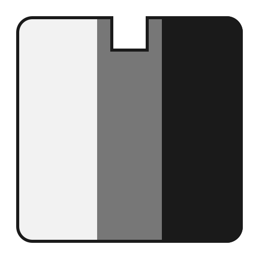
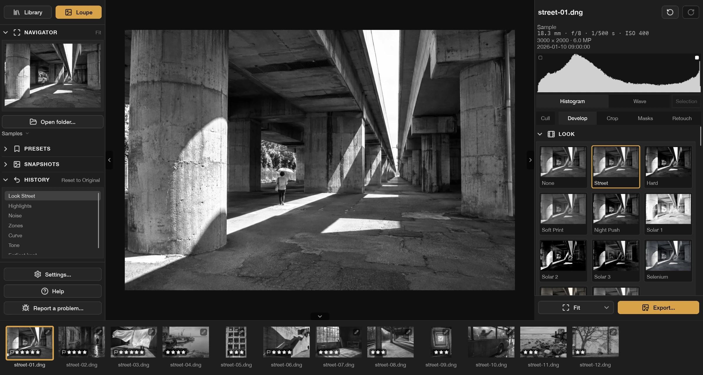

<!-- GitHub shows this page before the README.md at the top of the tree. That one is
     Greycard's, and stays as it is so that a rebase on Greycard does not touch it. -->



# Monocard

A raw photo editor for monochrome sensors. Free, and open source.



<sub>The sample pictures are generated, then developed in Monocard.</sub>

I shoot with a Ricoh GR IV Monochrome. It came with no software, and most editors run its
files through a color pipeline and turn them grey at the end. Monocard is made for monochrome
files only. It develops one channel, from the sensor's data to the print, and it has no color
tool.

Monocard is a soft fork of [Greycard](https://github.com/jessolmstead/greycard) by Jess
Olmstead. The library, the GPU pipeline, and most of the window are Greycard's.

**[Download for macOS](https://github.com/sbusso/monocard/releases/latest/download/Monocard.dmg)** ·
[Linux](https://github.com/sbusso/monocard/releases/latest/download/Monocard-linux-x86_64.AppImage) ·
[Windows](https://github.com/sbusso/monocard/releases/latest/download/Monocard-windows-x86_64.zip) ·
[Website](https://sbusso.github.io/monocard/) · [What it does](#what-it-does) ·
[Limits](#limits) · [Build](#build) · [Documentation](#documentation)

The Mac download is for Apple silicon with macOS 13.4 or later. It is notarized. The Linux and
Windows versions are for 64-bit Intel and AMD. They are new and have had little testing.

## What it does

- **One channel.** No demosaic, no white balance, and no color conversion. A monochrome
  camera's JPEG is edited with the same tools.
- **Color photos in grey.** A color raw or JPEG opens in grey, mixed through a black and
  white film filter: none, yellow, orange, red, green, or blue. Then the looks and tools work
  on it. A setting hides color photos.
- **Light and curve.** Sliders for light, a paper grade from 00 to 5 as darkroom paper, and
  a curve that is always in view. Sigmoid or AgX as the display transform.
- **Film.** Eighteen black and white films from Kodak, Ilford, and Fujifilm. Each film has
  its own curve, grain made of its silver grains, halation, and edge effect, and a color
  photo goes to grey through the film's color sensitivity. Develop it in D-76, HC-110, or
  Rodinal at a time, temperature, and agitation.
- **Darkroom print.** Six papers, split-grade printing, lith and cyanotype, and toner baths:
  selenium, sepia, gold, iron blue, copper, and vanadium.
- **Zones.** A view of the picture in zones 0 to X, and a tone equalizer of nine zones that
  keeps to edges.
- **Highlights.** A raw histogram of the sensor's own values, a map of what the sensor
  clipped, a shoulder into white, and a merge of brackets.
- **Detail.** Profiled, wavelet, and learned denoise that can keep some of the sensor's
  grain, a merge of a handheld burst for less noise, removal of JPEG blocks, local contrast,
  a contrast equalizer, and deblurring.
- **Looks.** Ten looks that stay editable: Street, Hard, Soft Print, Night Push, High Key,
  Selenium, Warm Fibre, and Solar 1 to 3. Grain, toning, vignette, and solarize. A look is a
  small text file. A look can come from a LUT, and go out as a LUT or a Lightroom profile.
- **The camera's picture modes.** Monocard reads the mode that a Ricoh GR recorded in the
  file, and its settings, such as Key and Contrast. It can fit a mode's look from pairs of
  DNG and JPEG that you shot. A raw opens with the look of its mode, as the camera's JPEG
  shows it.
- **Recipe book.** Keeps the camera's picture settings. Make a recipe from a photo, compare
  two, import, export, and copy one as text to set on the camera.
  [How well it fits](../docs/monocard/picture-controls.md).
- **Masks.** Brush, gradient, luminance, subject, and sky. Each one drives the same tone
  tools.
- **Import from the camera** by USB, on macOS, Linux, and Windows. The window opens when
  the camera is connected, shows its photos by day, and imports the ones you choose. It
  deletes nothing on the camera.
- **Grey output.** Grey JPEG, JPEG XL, Ultra HDR, 16-bit grey TIFF, and a proof on matte,
  baryta, or newsprint. The file has color only where the print is toned.
- **Your files stay yours.** Edits are in a `.mcd` file beside each photo. Monocard and
  Greycard can be installed together, and Monocard never changes Greycard's edits.
- **Command line.** `monocard develop` and `monocard export` run with no window.

## Limits

- I use it on an Apple silicon Mac. The Linux and Windows versions are built and checked by a
  workflow, and no one has used them yet. The Windows programs are not signed.
- Import from the camera by USB is new and has had little testing. On Linux and Windows it
  has not been tried with a camera.
- It is made for the Ricoh GR IV Monochrome. Other cameras' monochrome DNGs open, and they
  have had less testing.
- The noise profile of the GR IV Monochrome holds no measurements yet.
- The learned denoisers are general grey models, not trained on the GR IV Monochrome.
- Standard, Solid, and Solarized 1 to 3 are measured from the camera's own files. Soft, High
  Contrast, and HDR Tone are drafts. Grainy is not there. The bundled Solar looks are not
  matched against the camera.
- Clipped light is lost. A monochrome sensor has no other channel to take it from.
- The text that Monocard adds is in English only.

## Build

Set up the machine as [building.md](../docs/building.md) says. Then:

```sh
cargo build --release -p greycard-ui --features mono --bin monocard-ui
cargo build --release -p greycard-cli --features mono --bin monocard
scripts/ort-dylib.sh release
```

The last line gets the runtime of the subject and sky masks. On a Mac, use
`--features mono-usb` in the first line to add the import from the camera.
Other systems do not have it. To make a macOS app:

```sh
scripts/monocard-package.sh
```

## Documentation

- [Build, files, and trademarks](../docs/monocard/README.md)
- [What is built, and what is measured](../docs/monocard/STATUS.md)
- [The specification](../docs/monocard/SPEC.md)
- [The camera's picture modes](../docs/monocard/picture-controls.md)
- [The camera connection](../docs/monocard/camera-connection.md)
- [Contributing](../docs/monocard/CONTRIBUTING.md)
- [Greycard's user guide](../docs/user-guide.md), for the parts that the two programs share

## Credits and license

Built on [Greycard](https://github.com/jessolmstead/greycard) by Jess Olmstead,
GPL-3.0-or-later. Monocard is under the same license. It is a separate project, and it is not
published or endorsed by Greycard's author. Greycard's own README is
[here](../README.md).

Denoise, tone, and detail tools are ported from
[darktable](https://github.com/darktable-org/darktable), GPL-3.0-or-later. The import of
Lightroom's monochrome presets is adapted from
[RAWmakase](https://github.com/pch/rawmakase), MIT. The film and its print are ported from
[spektrafilm](https://github.com/andreavolpato/spektrafilm), GPL-3.0, with film and paper data
from [SpektraLab](https://github.com/JamesQiu2005/SpektraLab) and grain data from
[Negs](https://github.com/noahhaasis/negs), CC BY-SA 4.0. See the
[third-party notices](../docs/monocard/THIRD-PARTY-NOTICES.md).

Ricoh, GR, and GR IV Monochrome belong to Ricoh Imaging Company, Ltd. Monocard is not
affiliated with or endorsed by Ricoh Imaging.
