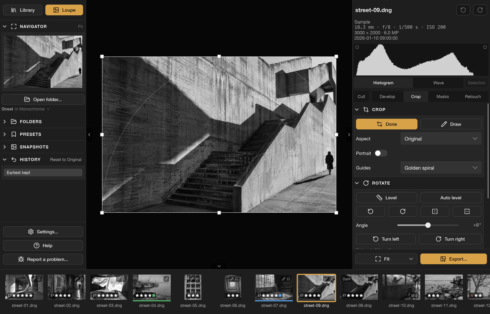
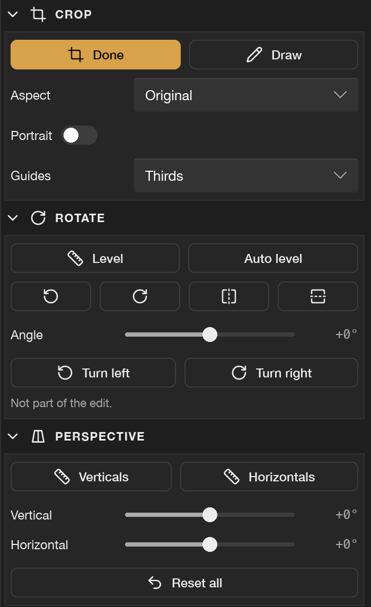
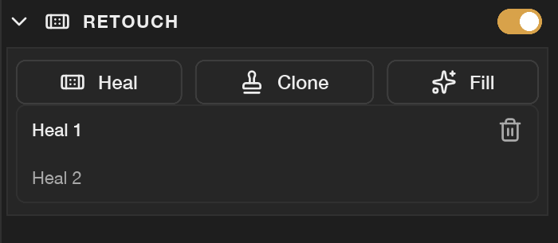

# Crop, lens, and retouch

Crop and straighten a photo, correct the lens, and remove dust and unwanted things. Crop and retouch are part of the edit and can be undone. They are never copied to other photos by [Sync](presets-and-history.md#copy-an-edit-to-other-photos). On a Mac, use Cmd where this guide says Ctrl.

## Crop

1. Click the **Crop** tab, press **R**, or click **Crop and straighten** under FINISH.
2. Under CROP, choose an **Aspect**, and then drag the edges or the corners of the crop.
3. Click **Done**, or press **R** again.

| Control | What it does |
| --- | --- |
| **Draw** | Draws a new crop on the photo |
| **Aspect** | **Free**, **Original**, **1:1**, **3:2**, **4:3**, **5:4**, **16:9**, **65:24**, or **Custom** |
| **Custom** | Your own aspect, shown when you choose it. Type the width and the height, as `7:5` |
| **Portrait** | Turns the aspect upright |
| **Guides** | **Thirds**, **Golden ratio**, **Golden spiral**, **Diagonals**, **Triangles**, or **None** |

Press **O** for the next guide. Press **Shift+O** to turn the spiral or the triangles. The aspect of a new crop is in [Settings](settings.md#editing).

A DNG shot in a crop mode, such as the 35 mm or 50 mm crop of a Ricoh GR, keeps the whole sensor. It opens at the camera's crop. To use the whole sensor, choose **Free** in the Crop tab and drag the edges out.

### Angle

Under ROTATE:

| Control | What it does |
| --- | --- |
| **Level** | Draw a line along something that must be level or upright |
| **Auto level** | Finds the angle from the photo |
| **Rotate left**, **Rotate right** | Turns the photo in the edit |
| **Flip**, **Flip vertical** | Mirrors the photo |
| **Angle** | Turns the photo by −45 to +45 degrees |
| **Turn left**, **Turn right** | Turns the photo as shown everywhere. It is not part of the edit |

### Perspective

Under PERSPECTIVE:

- **Verticals** and **Horizontals**: draw two lines on the photo, along edges that must be upright or level.
- **Vertical** and **Horizontal**: correct the perspective by hand, from −40 to +40 degrees.
- **Reset all** removes the crop, the rotation, and the perspective.

## Lens corrections

Click **Lens corrections** under FINISH to show or hide the LENS section.

| Control | What it does |
| --- | --- |
| **Maker**, **Find a lens**, **Lens** | Chooses the lens, if Monocard does not find it |
| **Get lens profiles** | Downloads the lens database. It is shown when there is none |
| **Profile** | Turns the profile on or off |
| **Distortion**, **Vignetting** | The strength of each correction |
| **Manual** | Your own correction, from −50 to +50 |
| **Auto scale** | Enlarges the photo to hide empty edges |
| **Scale** | Sets the size, from 50 to 200% |

If a DNG has its own distortion correction, Monocard uses that one and not the profile's. New edits start with lens corrections on. To change this, see [Settings](settings.md#editing). Monocard has no correction of chromatic aberration, because a monochrome photo has no color fringes to correct.

## Retouch

Click the **Retouch** tab. Choose **Heal**, **Clone**, or **Fill**, and then work on the photo.

| Tool | What it does |
| --- | --- |
| **Heal** | Copies another part of the photo and matches its brightness |
| **Clone** | Copies another part of the photo as it is |
| **Fill** | Removes a thing and makes a new picture in its place |

| Control | Range | Start |
| --- | --- | --- |
| **Size** | 0.2 to 30% | 2% |
| **Feather** | 0 to 100% | 30% |
| **Opacity** | 0 to 100% | 100% |

Use the wheel or **[** and **]** to change the size, **Shift+[** and **Shift+]** for the feather, and **Ctrl+[** and **Ctrl+]** for the opacity. Hold **Space** and drag, or **Shift** and drag, to move the photo.

The list in the section shows each repair, such as "Heal 1". Click one to choose it. Click its bin, **Remove**, to delete it.

For **Heal** and **Clone**, Monocard chooses the part to copy from. To change it, choose the repair in the list with the tool in hand. Two pins show the repair and its source. Drag them.

### Fill

1. Choose **Fill** and one of the three kinds.
2. Paint over the thing to remove, in one or more strokes. Strokes that touch become one fill.
3. Press **Enter** or click **Generate**. **Esc** drops the strokes.

| Kind | What it does | Download |
| --- | --- | --- |
| **Patch** | Fills from the picture around it | About 210 MB |
| **Fast** | Makes a new picture in four steps. It is rougher on large areas | 5.5 GB, and 390 MB more |
| **Best** | Makes a new picture in full. It takes longer | 5.5 GB |

Monocard asks before it downloads a model and shows its license. After that, everything runs on your computer and no photo is sent.

**Fast** and **Best** need a graphics card that Monocard can use, with at least 6.3 GiB of memory if it is a separate card. Without one, they are not available. On a fill that **Fast** or **Best** made, **Another** makes a different result.

Fill works on monochrome photos. The result is grey.
