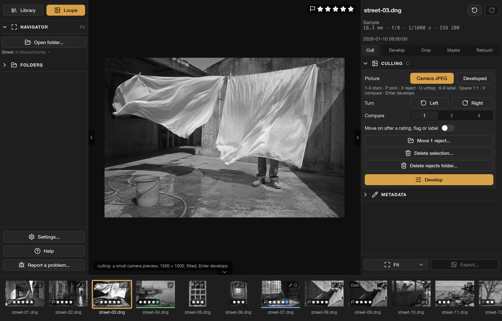
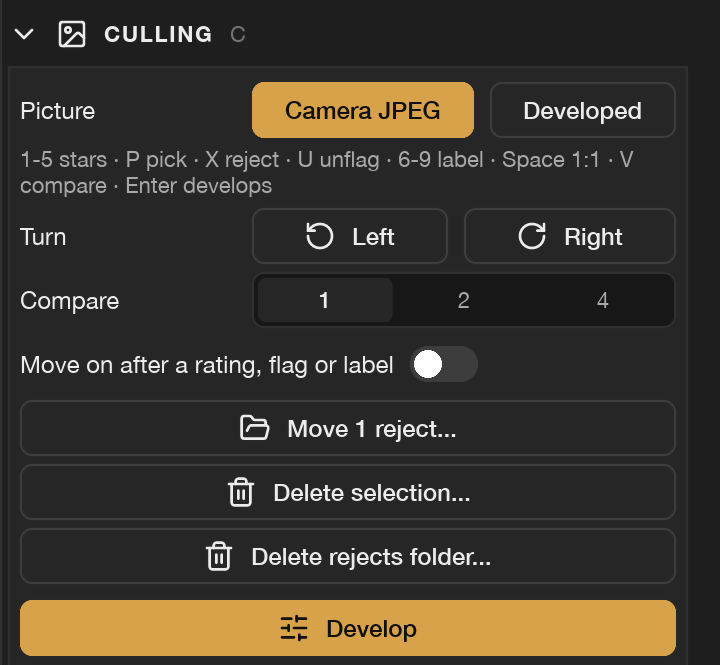
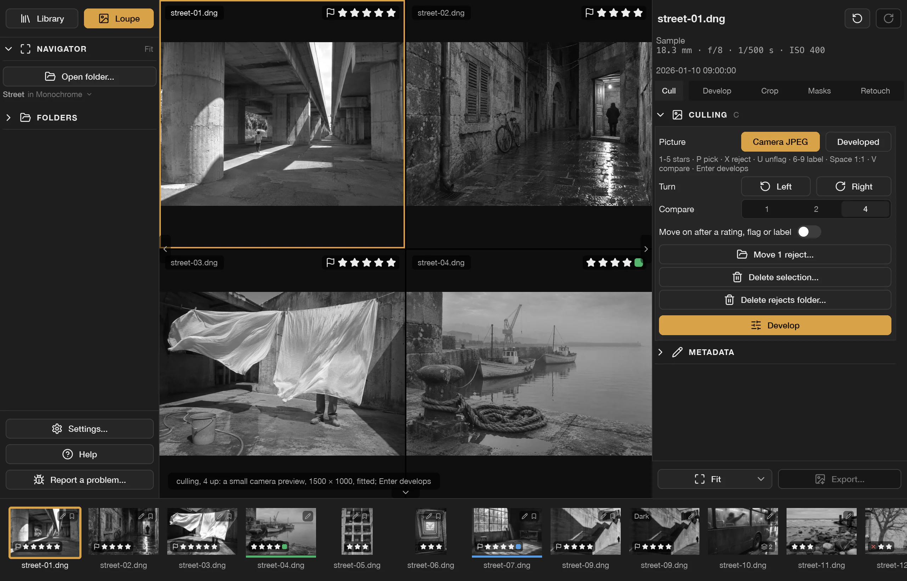
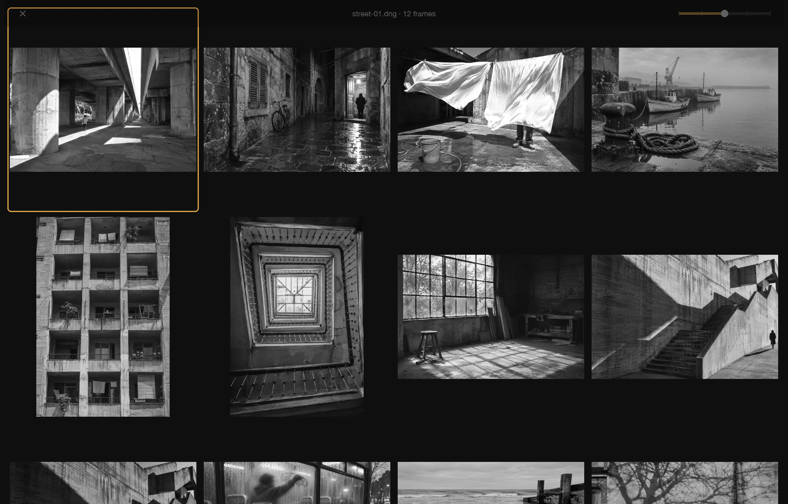

# Cull

To cull is to look through a shoot and to choose the photos to keep. You set flags, stars, and labels, and then you move the rejects out of the way. On a Mac, use Cmd where this guide says Ctrl.

## Flags, stars, and labels

| Mark | Keys | In the menu |
| --- | --- | --- |
| Stars | **1** to **5**. **0** clears them | **Rating** |
| Flag | **P** picks, **X** rejects, **U** clears | **Pick**, **Reject**, **Unflag** |
| Label | **6** red, **7** yellow, **8** green, **9** blue. The same key again clears it | **Label** |

The menu opens with a right-click on a photo. The purple label is in the menu only. Labels keep their colors in Monocard.

If you select more than one photo, a key or a menu item acts on all of them. **Ctrl+Z** undoes the last change of a mark, and **Ctrl+Shift+Z** does it again.

Marks are kept in the `.mcd` file of the photo, with your edit. All [versions](presets-and-history.md#versions) of a photo share them. To find photos by their marks, use the [filter bar](library.md#the-filter-bar).

## The Cull tab

Click **Cull** above the photo, or press **C** in the grid. In the Develop tab with a monochrome photo open, **C** shows the clip map. Click **Cull** there.

The panel has these rows under CULLING:

| Row | What it does |
| --- | --- |
| **Picture** | **Camera JPEG** shows the camera's picture, which opens fast. **Developed** shows your edit |
| **Turn** | Turns the photo: **Left** or **Right** |
| **Show** | The filter bar |
| **Compare** | Shows **1**, **2**, or **4** photos. It is available with **Camera JPEG** |
| **Move on after a rating, flag or label** | Goes to the next photo after each mark. It is off at first |
| **Move N rejects...** | Moves the rejects of the folder |
| **Delete selection...** | Deletes the selected photos |
| **Delete rejects folder...** | Deletes the photos in the `rejects` folder |
| **Develop** | Goes to the Develop tab |

METADATA is below CULLING, with the title, the caption, the keywords, and the capture data.

### Look closer

| Key | What it does |
| --- | --- |
| **Space** | Shows the photo at 1:1, or fits it |
| **Z** | Shows the photo at 3:1, or fits it |
| **Shift+J** | Focus peaking: marks the sharpest parts |
| **V** | Shows two photos, four photos, or one |
| **←** **→** | Goes to another photo |
| **Enter**, **D**, **Esc** | Goes to the Develop tab |

## Compare

Press **V**, or click **2** or **4** beside **Compare**. Monocard shows the photo and the ones next to it. The keys for stars, flags, and labels act on the photo that is chosen.

To compare the versions of one photo, use **Compare versions** in its menu. To compare the photos of a stack, use **Compare stack**.

## The lightbox

Press **L** to see the photos large, on a plain background. The background is the **Canvas** of [Settings](settings.md#editing).

- To show from two to six photos across, use **Tile size** or **+** and **−**. It starts at four.
- Use the arrow keys to choose a photo. The keys for stars, flags, and labels work here.
- Press **J** to show the marks on the photos.
- Press **Enter** to open the photo in the loupe.
- Press **Esc**, **G**, or **L**, or click ×, to leave.

## Move the rejects

1. Mark the photos with **X**.
2. Click **Move N rejects...**. The button shows the number of them.
3. Monocard asks **Move the rejects?** Click **Move**.

The photos go to a folder named `rejects` in the folder of the shoot. The `.mcd` file, the XMP file, and the camera's JPEG go with each one. A file in `rejects` is never written over. Nothing is deleted.

To undo the move, click **Move back**. The **Rejects** menu at the top of the grid shows how many rejects there are and has the same commands.

## Delete photos

Press **Delete** (or **⌫** on a Mac), or click **Delete selection...** or **Delete rejects folder...**. Monocard asks first. **Move to the trash** is the default button.

**Delete permanently** is offered only when the trash refuses the files. A permanent delete cannot be undone.

The `.mcd` and the XMP file are deleted with the photo, and all versions of the photo go with it. A `.gcd` file that Greycard wrote stays.

## Correct the time

If the camera's clock was wrong, select the photos and choose **Shift capture time of…** in the menu. Set **Shift by**, or use **Set this frame to** to give the correct time of one photo. The other selected photos shift by the same amount. Click **Apply**. **Clear shift** puts the camera's time back. The raw file is not changed.
