# Develop

The **Develop** tab edits the whole photo. This chapter goes through its six panels from top to bottom. To edit a part of the photo, see [Masks](masks.md).

## Work with the panels

- Click the title of a panel, or a line with an arrow such as **Levels**, to fold or open it.
- Click the reset arrow in a title to put the panel back to what the photo started with.
- Drag a slider. Hold **Shift** to move it a tenth as far. Double-click it to put it back to its default.
- Click the number of a slider to type a value.
- Click a slider, then use the arrow keys or the mouse wheel for small steps.

Every change is a step in [HISTORY](presets-and-history.md).

### Where a photo starts

A raw with no edit starts from its camera's profile. The one for the Ricoh GR IV Monochrome sets **Sharpen** to **Capture** at 25% and turns **Link to ISO** on. You can also start from [the camera's picture mode](looks.md#start-from-the-cameras-mode).

### Develop a JPEG

The camera already rendered a JPEG, so Monocard applies no display transform to it, and it starts as the camera made it. **Display transform**, and **Contrast**, **Shoulder**, and **Toe** under **Transform**, do not show. The camera profile and the hot pixel repair do not apply. If strong edits make the JPEG's 8 by 8 blocks show, use [Remove JPEG blocks](#remove-jpeg-blocks).

## Keys

| Key | What it does on the Develop tab |
| --- | --- |
| **A** | Shows the photo before your edit |
| **B** | Shows your edit |
| **S** | Shows before and after, split, and back |
| **Z** | Zone view, on or off |
| **C** | Clip map, on or off |

Elsewhere, some of these keys do something else. See [Keys](keys.md).

## Scopes

The scopes stay above the tabs. **Histogram** shows how many pixels are at each level. **Wave** shows the levels across the width of the picture. **Raw** shows what the sensor recorded, before any edit, in stops under its clip point. **Selection** counts only the pixels of the chosen mask, on the Masks tab. Point at the picture to see its level, **L** from 0 to 255.

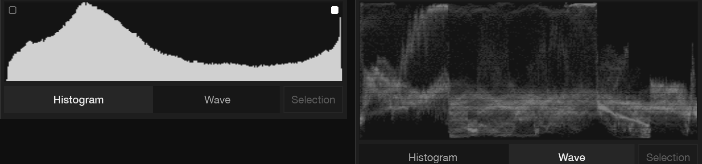

The numerals over **Raw** are zones, a stop each, with **V** at middle grey. The line under it says how much of the photo clipped, and how many stops its brightest light that did not clip is under the clip point. No slider changes it. A JPEG has no **Raw**.

The squares in the corners of **Histogram** light when the picture reaches black or white. Click one to mark those pixels with lines. **J** turns both marks on or off. They show what the file clips. The [clip map](#highlights) shows what the sensor clipped.

## LOOK

A look sets several controls at once. Click a tile to put it on, and **None** to take it off. **Strength** goes from 0 to 100%. See [Looks](looks.md).

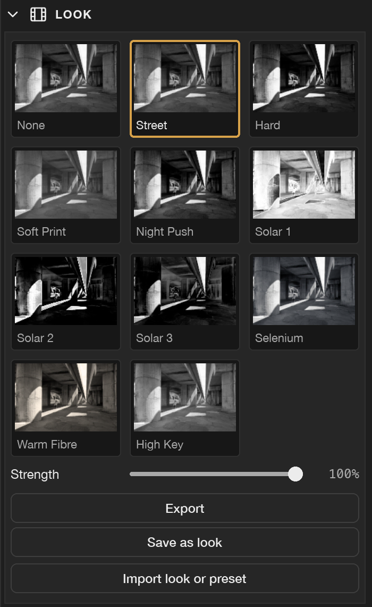

## BASIC

| Control | Range | Default | What it does |
| --- | --- | --- | --- |
| **Filter** | **None**, **Yellow**, **Orange**, **Red**, **Green**, **Blue** | **None** | On a color photo only. Mixes its colors into grey as a black and white film filter does. See [Color photos](#color-photos) |
| **Exposure** | -5 to +5 EV | 0 | Brightens or darkens in stops |
| **Contrast** | -100 to +100 | 0 | Changes contrast around middle grey |
| **Blacks** | -100 to +100 | 0 | Lifts or lowers the tones below middle grey |
| **Midtones** | -100 to +100 | 0 | Lightens or darkens between black and white |
| **Whites** | -100 to +100 | 0 | The same control as **Shoulder** in [HIGHLIGHTS](#highlights). Positive values compress |
| **Display transform** | **Sigmoid**, **AgX** | **Sigmoid** | Fits the light of the scene to the screen and the print. Off when a film is set in [FILM](#film) |

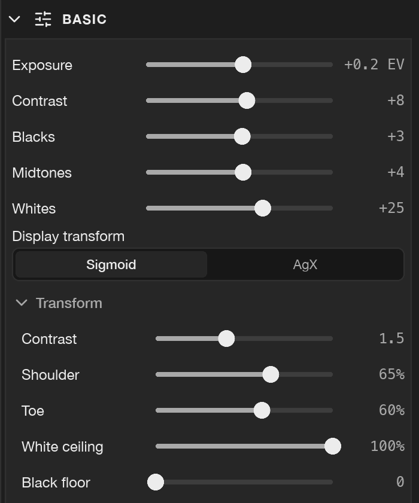

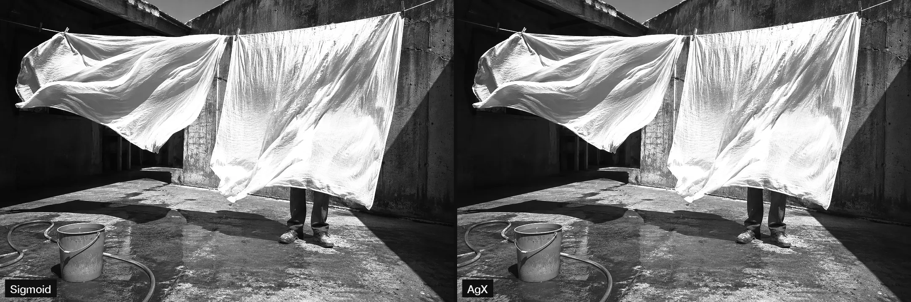

### Color photos

Monocard opens a color photo in grey. It uses Greycard's color develop with the camera's own white balance, and then mixes red, green, and blue into one grey picture. After that, every panel and every look works on it as on a monochrome photo.

**Filter** sets the mix. **None** gives the lightness that the eye sees. The others work as color filters on black and white film: a filter lightens its own color and darkens the opposite one. A grey stays the same grey through every filter.

| Filter | Use it to |
| --- | --- |
| **Yellow** | Darken a blue sky a little |
| **Orange** | Darken a blue sky more, and soften skin |
| **Red** | Make a blue sky almost black, and lighten red |
| **Green** | Lighten leaves and grass, and darken red and skin |
| **Blue** | Lighten a blue sky, and darken red and yellow |

The filters are first versions, not measured filters. With a film in [FILM](#film), the mix is the film's color sensitivity, and the filter acts on the light before the film. The grid shows a color photo's camera preview in grey without the filter until the photo has an edit.

### Transform

| Control | Range | Default | What it does |
| --- | --- | --- | --- |
| **Contrast** | 0.5 to 3 | 1.5 | The slope at middle grey |
| **Shoulder** | 0 to 100% | 50% | How softly the highlights roll off |
| **Toe** | 0 to 100% | 50% | How softly the shadows roll off |
| **White ceiling** | 50 to 100% | 100% | The light of paper white |
| **Black floor** | 0 to 0.1 | 0 | The light of the deepest black |

### Curve

**Preset** sets the curve to **Linear**, **Soft S**, **Strong S**, **Lifted**, or **Faded**. Click the curve to add a point, up to 16. Drag a point to move it. Double-click a point to remove it. The two end points stay.

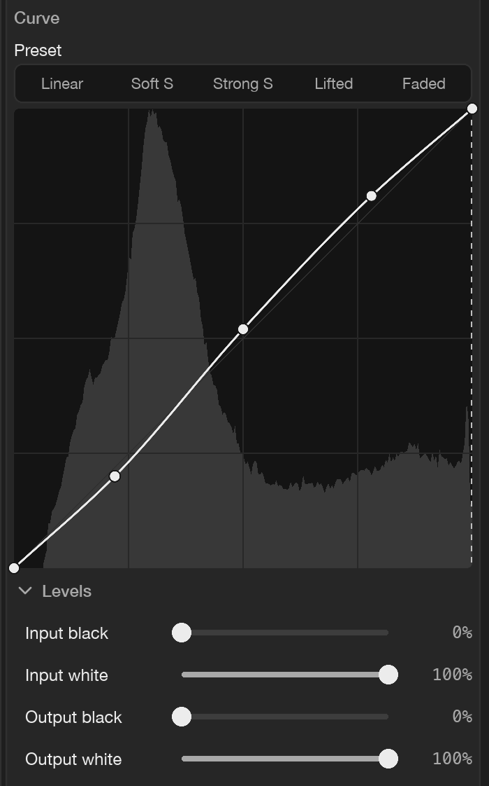

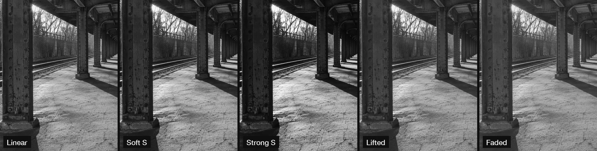

The histogram is behind the curve. When the sensor clipped in the photo, a dashed line shows where its white is, and the part beyond it is hatched.

**Levels** has **Input black**, **Input white**, **Output black**, and **Output white**, each from 0 to 100%.

## FILM

FILM exposes the photo on a black and white film, develops it, and prints the negative on a darkroom paper. The film's print then takes the place of the display transform.

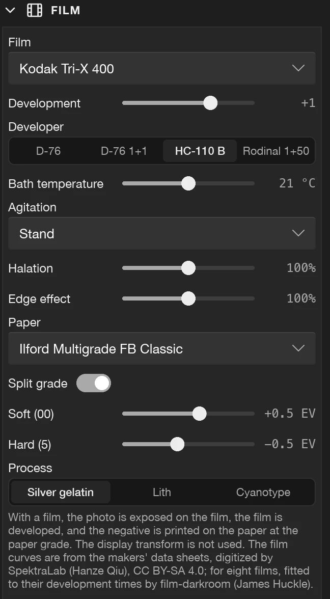

| Control | Range | Default | What it does |
| --- | --- | --- | --- |
| **Film** | **None** and 18 films | **None** | The film the photo is exposed on. **None** keeps the display transform of BASIC |
| **Development** | -3 to +3 | 0 | Push (+) or pull (-). One step is about 19% more time in the developer, a push of one stop. Middle grey stays where it is |
| **Developer** | **D-76**, **D-76 1+1**, **HC-110 B**, **Rodinal 1+50** | **D-76** | Each at its own normal time. It changes the grain, the edge effect, and how the temperature and the agitation act. With a film only |
| **Bath temperature** | 18 to 24 °C | 20 °C | A warmer developer works faster: the same time gives a harder negative. With a film only |
| **Agitation** | **Continuous**, **Every 30 s**, **Every minute**, **Semi-stand**, **Stand** | **Every 30 s** | Each at its own normal time. Less agitation holds back the highlights and makes a stronger edge effect. With a film only |
| **Halation** | 0 to 200% | 100% | A soft glow around bright points, from light that bounces off the back of the film. With a film only |
| **Edge effect** | 0 to 200% | 100% | A dark and a light rim along an edge, from the developer. It makes the negative look sharper. With a film only |
| **Paper** | Six papers | **Ilford Multigrade IV RC** | The paper the negative is printed on. With a film only |
| **Split grade** | On, off | Off | Prints with two exposures, through filter 00 and filter 5, in place of **Paper grade**. On an Ilford Multigrade paper, with a film |
| **Paper grade** | 00 to 5 | 2 | Changes contrast as darkroom paper does. Low grades are soft, with more greys. High grades are hard, with more black and white. With a film, it sets the paper's filter. Without one, middle grey, black, and white stay where they are. It works the same on a raw and on a JPEG |
| **Soft (00)**, **Hard (5)** | -3 to +3 EV | 0 | The two exposures of a split-grade print, in stops of time (EV). Shown in place of **Paper grade** |
| **Process** | **Silver gelatin**, **Lith**, **Cyanotype** | **Silver gelatin** | How the print is made. Lith and cyanotype work with or without a film |
| **Overexposure** | 0 to 4 EV | 0 | Lith and cyanotype: exposure over the normal print. Lith printers often give 2 to 3 stops |
| **Snatch**, **Abruptness** | 0 to 100% | 55%, 60% | Lith: how early the shadows go black, and how suddenly |
| **Sensitizer** | **Classic**, **New** | **Classic** | Cyanotype: Herschel's formula, or Mike Ware's, which holds a deeper blue |
| **Range** | 0.5 to 3 | 1.4 | Cyanotype: the density range the sensitizer holds. Lower is harder |
| **Bleach**, **Tannin** | 0 to 100% | 0% | Cyanotype: washing soda clears the blue from the highlights; tannin turns what is left brown |

The films are Kodak Tri-X 400, T-Max 100, T-Max 400, T-Max P3200, Plus-X 125 and Double-X 5222; Ilford HP5 Plus, FP4 Plus, Pan F Plus 50, Delta 100, Delta 400, Delta 3200, SFX 200, XP2 Super and Ortho Plus 80; and Fujifilm Acros II, Neopan 400 and Neopan 1600.

Each film is its characteristic curve, from the maker's data sheet: how dark the negative gets for each amount of light. A film with a long toe, such as Tri-X, keeps more shadow detail. A film with a short one, such as Pan F Plus, makes deeper blacks.

Eight films develop as their data sheets show: Kodak Tri-X 400, T-Max 100 and T-Max 400, from Kodak's curves at several times in D-76, and Ilford HP5 Plus, FP4 Plus, Delta 100, Delta 400 and Delta 3200, from Ilford's curve. On these, a longer time raises the highlights much more than the shadows and gains some speed, as a real push does. On the other ten films, **Development** makes the negative's contrast higher or lower by a fixed step.

The papers are Ilford Multigrade IV RC, Multigrade FB Classic and Multigrade Warmtone, Kodak Polymax II RC and Polycontrast IV RC, and Foma Fomatone. Each grade is timed so that middle grey prints the same. FB Classic has a deeper black than the RC paper. Polycontrast IV has grades 1 to 5 only; a lower grade prints as 1. On Multigrade Warmtone and Fomatone the silver is warm, so the photo is toned and [exports in color](export.md#grey-or-color).

In a split-grade print, the soft exposure prints the light tones and the hard exposure fills the shadows. At 0 and 0 the print matches grade 2 at middle grey and two stops under it. Give more **Soft (00)** to darken the light tones, and more **Hard (5)** to darken the shadows.

A lith print has creamy, low-contrast highlights set by the exposure, and shadows that turn black past a point set by **Snatch**. Its color follows the paper: warm on Fomatone, nearly neutral on the others. A cyanotype is Prussian blue and never goes black. Paper white stays white in both. Both are toned photos.

A color photo goes to grey through the film's own color sensitivity, and through the **Filter** of BASIC. So Ortho Plus 80, which does not see red, makes red lips and red bricks dark. A monochrome photo has no color, so this does not change it.

The film also sets the grain. A fast film, such as Delta 3200, has large grain. A slow one, such as Pan F Plus, has fine grain. Monocard renders the negative's silver grains at the size that matches each film's published granularity, on a 35 mm frame across the photo, so the grain has the same size in the print whether the file is small or large. A crop enlarges the grain with the picture, as it would on film. The grain is weak in the print's shadows, strongest in the midtones and light tones, and none in the paper's white. In [Grain](#grain), **Amount** scales it and **Size** makes the grains smaller or larger than the film's (30% is the film's own). **Roughness** and **Link to ISO** are hidden with a film.

The film's print, grain, halation and edge effect are the same on the screen and in an export. The curves were digitized from the makers' data sheets by SpektraLab (Hanze Qiu), under CC BY-SA 4.0. The film model is ported from spektrafilm (Andrea Volpato). The development, the fitted curves, and the Kodak papers are from film-darkroom (James Huckle); Multigrade Warmtone from film_tests (Rafal Lukawiecki); FB Classic, Fomatone, lith, cyanotype, and the toners from NegPy; the split-grade print from mimizan (Dragan Bojovic).

### Grain

| Control | Range | Default | What it does |
| --- | --- | --- | --- |
| **Amount** | 0 to 100% | 0% | The strength, most in the midtones |
| **Size** | 0 to 100% | 30% | The size of the grain. With a film, 30% is the film's grain size |
| **Roughness** | 0 to 100% | 50% | How rough the grain is. Not shown with a film |
| **Link to ISO** | On, off | Off | Makes the grain stronger at a high ISO. Not shown with a film, whose grain is set by its speed |

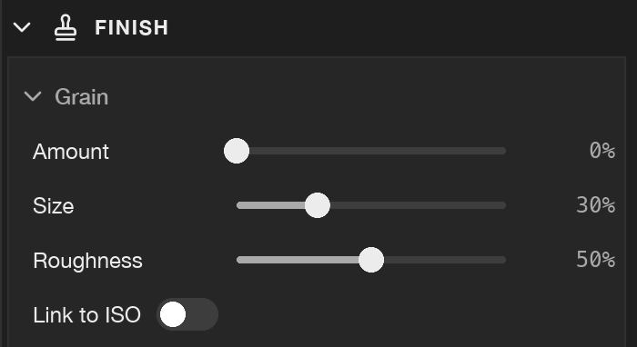

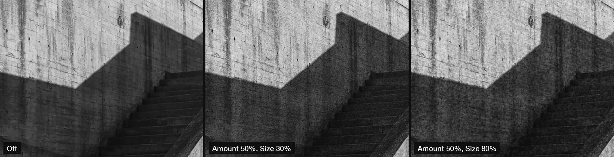

## LIGHT

LIGHT is the tone equalizer. It lightens or darkens each tone and keeps edges. The nine sliders, **-8 EV** to **0 EV**, are one stop of light each, from the deepest shadows to the brightest light. Each one goes from -2 to +2 EV.

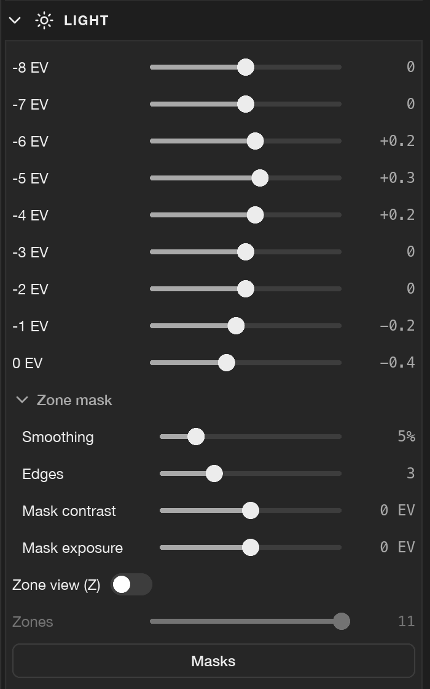

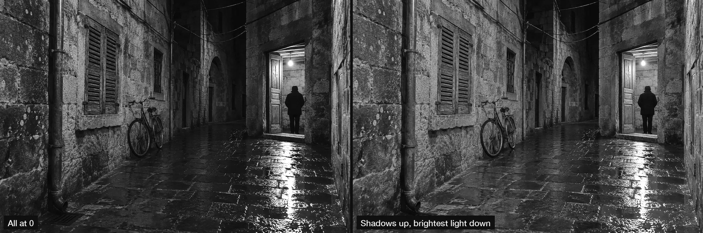

### Zone mask

The zone mask is a smoothed copy of the photo. It decides which slider acts where.

| Control | Range | Default | What it does |
| --- | --- | --- | --- |
| **Smoothing** | 0 to 25% | 5% | The width of the smoothing, as a share of the short edge |
| **Edges** | 0 to 10 | 3 | How hard the mask keeps edges |
| **Mask contrast** | -2 to +2 EV | 0 | Spreads the tones over more of the sliders, or fewer |
| **Mask exposure** | -4 to +4 EV | 0 | Moves the tones along the sliders |

### Zone view

**Zone view (Z)** paints the picture in flat greys, one for each zone, with a legend. **Zones** sets how many, from 5 to 11. Eleven are zones 0 to X. An export does not have them.

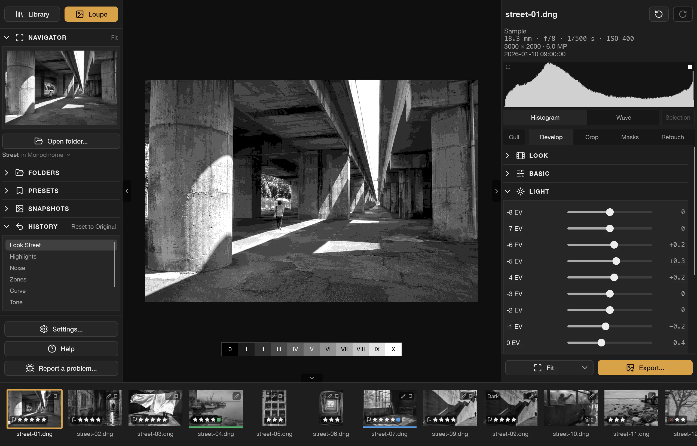

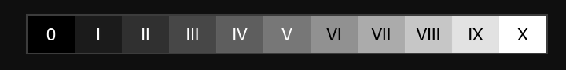

**Masks** opens the [Masks](masks.md) tab.

## DETAIL

### Denoise

| Control | Range | Default | What it does |
| --- | --- | --- | --- |
| **Denoise** | **Off**, **Profiled**, **Wavelet**, **Fast**, **Best** | **Off** | Chooses the method. **Fast** and **Best** are learned models. See [Learned denoise](#learned-denoise) |
| **Strength** | 0 to 100 | 50 | How much noise goes |
| **Detail** | 0 to 100 | 50 | How much detail comes back. **Profiled** and **Wavelet** only |
| **Shadows** | 0 to 100 | 0 | More smoothing in the deepest tones. **Profiled** and **Wavelet** only |
| **Keep sensor grain** | 0 to 100 | 0 | Puts back a part of the noise |
| **Raw threshold from the profile** | On, off | On | Takes the raw threshold from the camera profile |
| **Raw threshold** | 0 to 100 | 0 | A light denoise of the raw data, also with **Denoise** off. Dimmed while the switch above is on |
| **Merge burst** | | | Merges 2 to 16 frames at one exposure that you selected in the filmstrip into one with less noise. See [Merge](merge.md#merge-burst) |
| **Remove JPEG blocks** | 0 to 100 | 0 | On a JPEG only. Removes the 8 by 8 pixel blocks of the JPEG compression. See [Remove JPEG blocks](#remove-jpeg-blocks) |

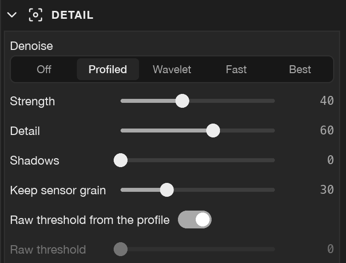

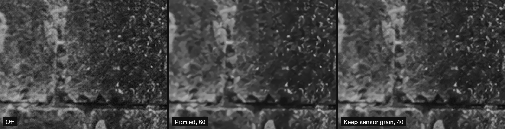

#### Learned denoise

**Fast** and **Best** are networks trained on many photos to tell noise from detail. Monocard downloads each one the first time you choose it, after it shows you the model's license. You can also download them on the [Models](settings.md#models) page of Settings.

| Choice | Model | Download | Time for a 24 MP photo on an M5 Max |
| --- | --- | --- | --- |
| **Fast** | FFDNet | 2 MB | about 1.5 s |
| **Best** | DRUNet | 131 MB | about 10 s |

**Best** keeps more fine detail than **Fast**. Both read the noise of the photo from the camera profile, so one model works at every ISO. **Strength** mixes the result with the photo: at 50, the mix is the one that the camera profile gives for the ISO, and lower values keep more of the noise. **Detail** and **Shadows** do nothing to them.

Monocard runs the learned denoise only for the full develop of the photo and for an export. While you move a slider, the photo shows without it for a moment. Until the model is downloaded, or where it cannot run, **Profiled** stands in, and the status line says so.

#### Remove JPEG blocks

A JPEG is saved in blocks of 8 by 8 pixels. Curves, local contrast, and sharpening can make the edges of these blocks show, mostly in the sky and other smooth areas. **Remove JPEG blocks** finds how strongly the photo was compressed and removes the blocks to match. It runs at the start of the develop, before the other tools. The control shows on a JPEG only.

| Value | What it does |
| --- | --- |
| 0 | Off |
| 50 | Removes the blocks as strongly as the compression that the model reads from the photo |
| 75, 100 | Removes more: two and four times as much, which also smooths fine detail |
| 25, 1 | Removes less |

The model is FBCNN, a 288 MB download. Download it on the [Models](settings.md#models) page of Settings before you use the control; without it, the photo is left as it is. It takes about the same time as **Best**, and it also runs only for the full develop and for an export.

### Sharpen

**Sharpen** is **None**, **Capture** for fine detail, **Deblur** for the blur of the lens, or **Local** for local contrast. **Strength** goes from 0 to 100%. The default is 50%.

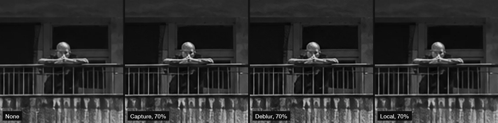

### Local contrast

Each slider goes from -100 to +100.

| Control | What it changes |
| --- | --- |
| **Amount** | The local contrast at every size |
| **Detail** | The fine detail only |
| **Highlights** | The contrast in the highlights |
| **Shadows** | The contrast in the shadows |

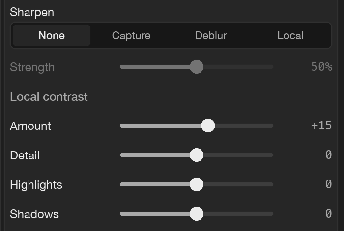

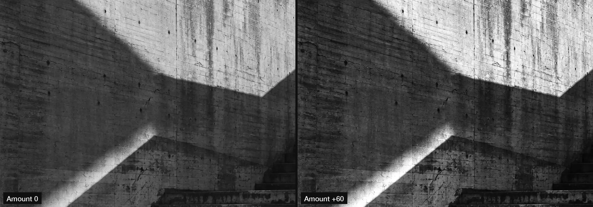

### Contrast equalizer

**Fine**, **Medium**, **Coarse**, and **Structure** change contrast by size, from fine texture to large forms. Each one goes from -100 to +100.

**Curve by scale** has a bar for each of eight sizes, the finest at the left. Drag a bar, with **Shift** for finer moves. Double-click it to put it back to 0. The bars add to the four sliders.

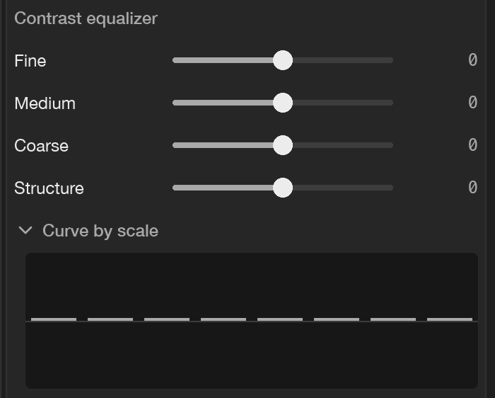

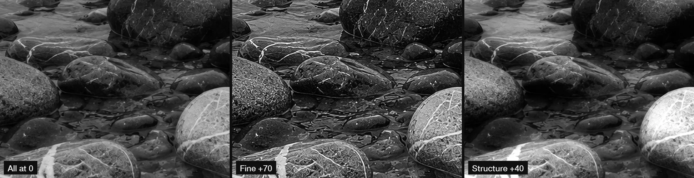

## HIGHLIGHTS

Clipped data is lost. These controls shape the way into white.

| Control | Range | Default | What it does |
| --- | --- | --- | --- |
| **Clip map (C)** | On, off | Off | Marks with diagonal stripes what the sensor clipped |
| **Shoulder** | -100 to +100 | 0 | Compresses the last 1.5 stops before clipping. Negative values open them |
| **Edge inpaint** | On, off | Off | Smooths the border of a clipped area |
| **Radius** | 2 to 6 px | 4 px | The reach of **Edge inpaint** |
| **Merge brackets** | | | Merges 2 to 5 frames that you selected in the filmstrip. See [Merge](merge.md) |

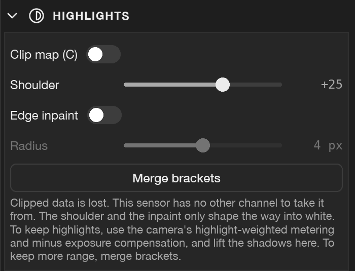

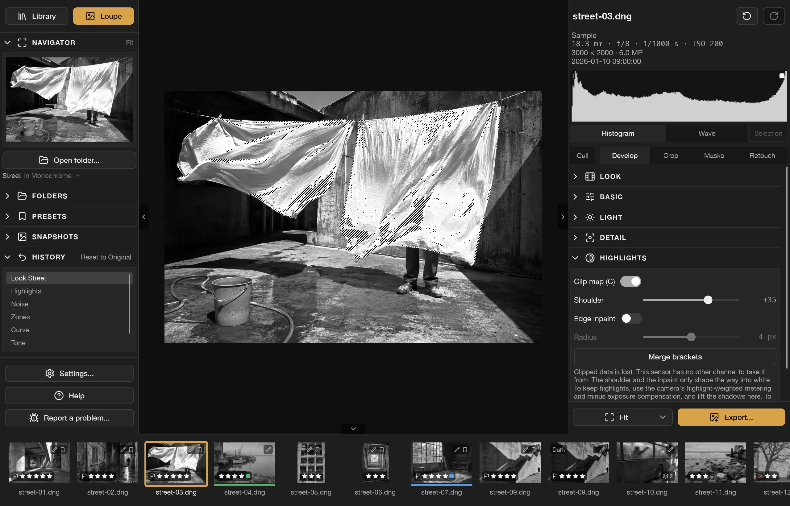

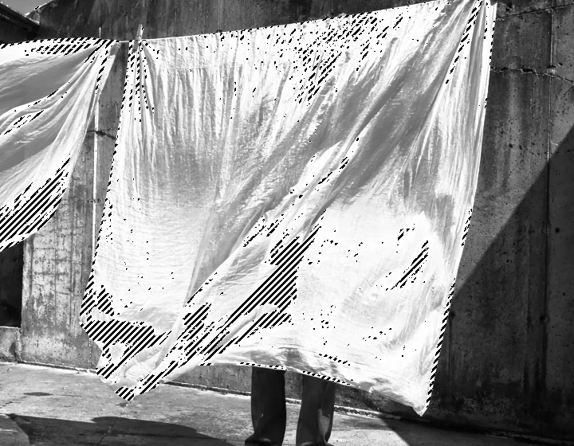

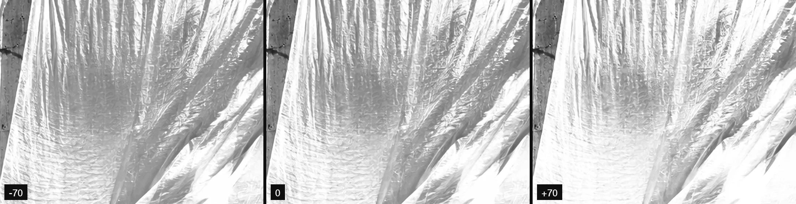

To keep highlights, use the camera's highlight-weighted metering and negative exposure compensation, and lift the shadows in Monocard.

## FINISH

### Toning

Toning makes color, as do a lith or cyanotype print and a warm-tone paper in [FILM](#film). A toned photo is [exported in color](export.md#grey-or-color). **Toning** sets the sliders below it to **None**, **Selenium**, **Sepia**, **Platinum**, **Cyanotype**, or **Gold**. **Selenium**, **Sepia**, and **Gold** put the print in that toner's bath; **Platinum** and **Cyanotype** set tints.

| Control | Range | What it does |
| --- | --- | --- |
| **Overall hue**, **Overall** | 0 to 360°, 0 to 100% | Hue and amount for all tones |
| **Highlights hue**, **Highlights** | 0 to 360°, 0 to 100% | Hue and amount for the highlights |
| **Shadows hue**, **Shadows** | 0 to 360°, 0 to 100% | Hue and amount for the shadows |
| **Balance** | -100 to +100 | Negative values spread the tint of the shadows, positive values that of the highlights |
| **Selenium** | 0 to 100% | Converts the densest silver first: deeper blacks with a purple-brown cast, light tones as they were |
| **Sepia** | 0 to 100% | Converts the thinnest silver first: brown highlights and midtones, the deepest black stays |
| **Gold** | 0 to 100% | Blue-black, from the highlights in. After **Sepia** it turns the brown to red |
| **Iron blue** | 0 to 100% | Prussian blue, strongest in the shadows |
| **Copper** | 0 to 100% | Red to pink, and a little lighter |
| **Vanadium** | 0 to 100% | Green, from the highlights in |

A bath acts on the print's density, so paper white stays white. The tints go over the bath's color and keep its lightness. The baths do not act on a cyanotype, which has no silver. On a lith print, selenium reaches further into the midtones and gold acts on every density alike. An edit made before the baths existed keeps its tints and looks as it did; choosing a preset again uses the bath.

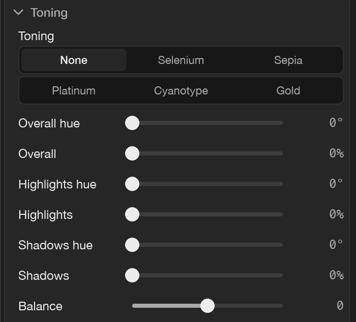

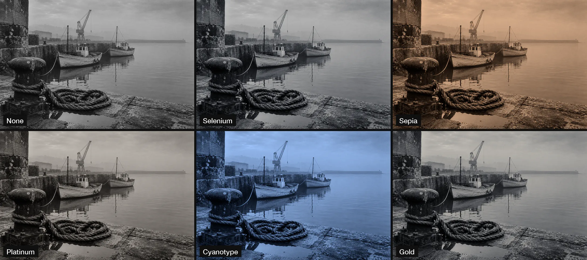

### Vignette

| Control | Range | Default | What it does |
| --- | --- | --- | --- |
| **Amount** | -100 to +100 | 0 | Darkens or lightens the corners |
| **Midpoint** | 0 to 100 | 50 | How far from the center it begins |
| **Feather** | 0 to 100 | 50 | How soft it is |
| **Roundness** | 0 to 100 | 50 | 0 is a rounded rectangle, 50 the shape of the frame, 100 a circle |

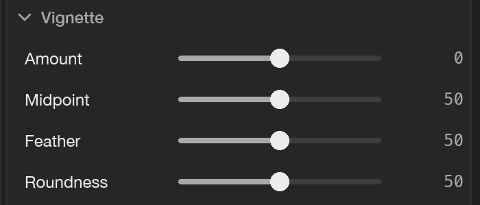

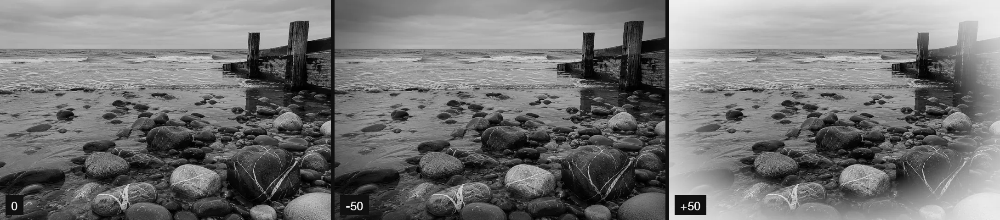

### Solarize

**Solarize** reverses tones: **Mid** about the middle, **Ends** at both ends, or **Shadows** in the shadows. **Off** is the default. **Fitted** shows when a fitted look set a curve of its own. **Strength** goes from 0 to 100%.

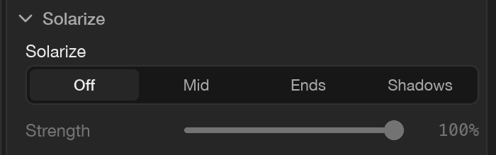

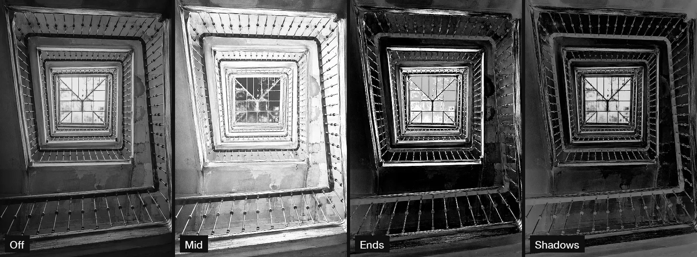

### View and proof

These controls change the view, not the file.

| Control | Choices | What it does |
| --- | --- | --- |
| **Surround** | **18% grey**, **Black**, **White** | Sets the tone around the picture |
| **Picture** | **After**, **Before**, **Split** | The same as **B**, **A**, and **S** |
| **Paper proof** | **Off**, **Matte**, **Baryta**, **Newsprint** | Shows a [paper proof](export.md#paper-proof) |

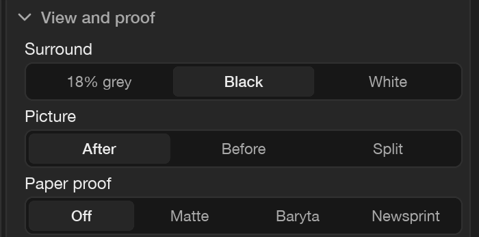

In **Split**, drag the handle to move the line, or click it and use the arrow keys. Double-click it to center the line.

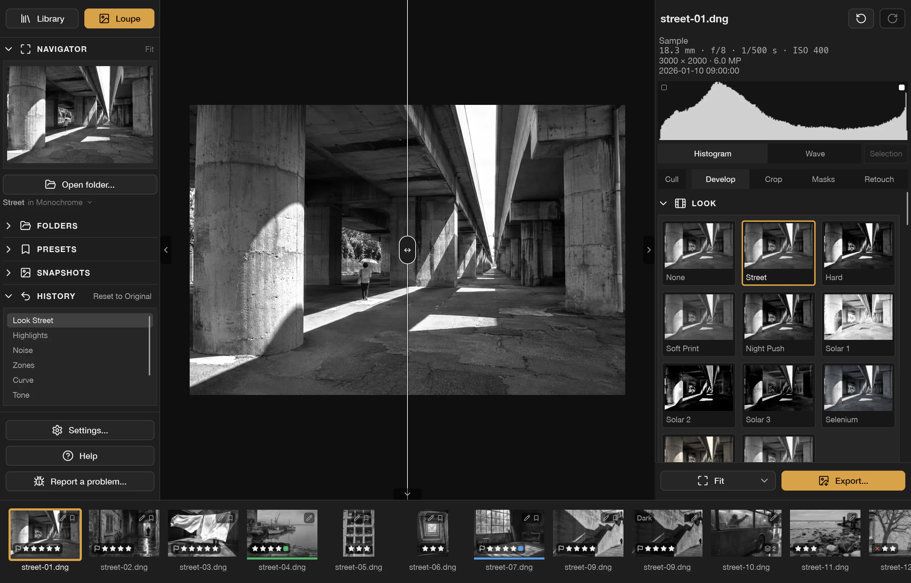

### Crop and lens

**Crop and straighten** opens the [Crop](crop-and-retouch.md) tab. **Lens corrections** shows or hides the **LENS** panel under FINISH:

| Control | What it does |
| --- | --- |
| **Maker**, **Find a lens**, **Lens** | Choose the lens |
| **Get lens profiles** | Downloads the profiles. It shows when there are none |
| **Profile** | Uses the profile of the lens |
| **Distortion**, **Vignetting** | Turn each correction on or off |
| **Manual** | Corrects distortion by hand, -50 to +50 |
| **Auto scale** | Enlarges the picture to hide empty edges |
| **Scale** | 50 to 200%, with **Auto scale** off |
