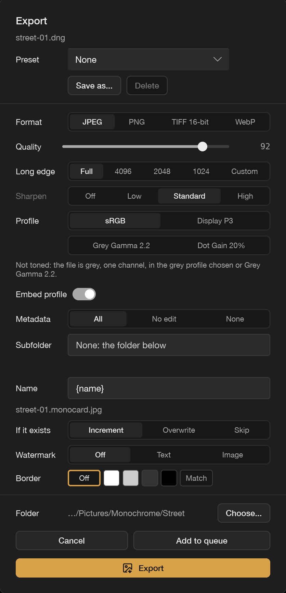

# Export

An export writes your photo as a new file, with its edit. This chapter covers the Export sheet, grey and color files, the queue, and the paper proof.

## Open the sheet

Click **Export...** at the bottom of the right pane, press **Ctrl+Shift+E**, or right-click a photo and choose **Export...**. With two or more photos selected, each one is exported with its own edit.

After an export from the sheet, **Ctrl+E** exports again with the same choices, and the sheet does not open.

## Grey or color

| The photo | The file | The profile |
| --- | --- | --- |
| Not toned | One grey channel | **Grey Gamma 2.2** or **Dot Gain 20%**. With another choice, Grey Gamma 2.2 |
| Toned | RGB | **sRGB** or **Display P3**. With another choice, sRGB |

A photo is toned when an amount in [Toning](develop.md#toning) is over 0. The line under **Profile** says which file you get. Use Grey Gamma 2.2 for screens, and Dot Gain 20% when a printer asks for it.

## The rows of the sheet

| Row | Choices | Default | What it does |
| --- | --- | --- | --- |
| **Preset** | Your presets | **None** | Sets all the rows |
| **Format** | **JPEG**, **PNG**, **TIFF 16-bit**, **WebP** | JPEG | JPEG is the smallest. TIFF 16-bit keeps the most tones. The others are 8 bits |
| **Quality** | 50 to 100 | 92 | For JPEG only |
| **Long edge** | **Full**, **4096**, **2048**, **1024**, **Custom** | Full | The longer side in pixels. A photo is never made larger |
| **Sharpen** | **Off**, **Low**, **Standard**, **High** | Standard | Sharpens after the picture is made smaller. At the full size it does nothing |
| **Profile** | **sRGB**, **Display P3**, **Grey Gamma 2.2**, **Dot Gain 20%** | sRGB | See [Grey or color](#grey-or-color) |
| **Embed profile** | On, off | On | Writes the profile in the file |
| **Metadata** | **All**, **No edit**, **None** | All | The camera's data and the edit, the camera's data, or nothing |
| **Subfolder** | A name | Empty | A folder beside each original. It wins over **Folder** |
| **Name** | A pattern | `{name}` | The name of the file. See [Names](#names) |
| **If it exists** | **Increment**, **Overwrite**, **Skip** | Increment | See [Existing files](#existing-files) |
| **Watermark** | **Off**, **Text**, **Image** | Off | A mark over the picture |
| **Border** | **Off**, four greys, **Match** | Off | A band around the picture |
| **Folder** | **Choose...** | The last one chosen | Where **Export** writes |

### Watermark

Choose **Text** and type a line in **White** or **Black**, or choose **Image** and a PNG file. Click a square of the grid to place it. **Size** goes from 1 to 50% of the long edge, **Margin** from 0 to 10%, and **Opacity** from 5 to 100%. In a grey file, the mark is grey.

### Border

Click **White**, light grey, dark grey, **Black**, or **Match**. Match is the mean tone of the picture. **Width** goes from 0.5 to 25% of the long edge. The border is added outside the picture, so the file is larger. The window does not show it.

### Names

| Token | Becomes |
| --- | --- |
| `{name}` | The name of the original |
| `{seq}` | The number of the photo in the export. `{seq:101}` starts at 101 |
| `{date}` | The day it was taken. `{date:%Y%m%d}` sets the form |
| `{camera}` | The camera |

In the folder of the original, the file is `IMG_0001.monocard.jpg`, so it never takes the name of the camera's JPEG.

### Existing files

- **Increment** writes `IMG_0001-1.jpg` beside the file.
- **Overwrite** replaces it. Monocard lists the files first, and asks.
- **Skip** writes nothing.

## Presets

A first start has four presets:

| Preset | What it writes |
| --- | --- |
| **Grey JPEG** | JPEG, quality 92, Grey Gamma 2.2 |
| **Grey TIFF** | 16-bit TIFF, Grey Gamma 2.2 |
| **Toned JPEG** | JPEG, quality 92, sRGB |
| **Web** | JPEG, quality 85, 2048 on the long edge, sharpened |

To make your own, set the rows, click **Save as...**, and type a name. **(edited)** shows when the rows are no longer those of the preset. **Delete** removes the preset.

## Stop an export

While several photos are exported, **Export...** becomes **Stop export**. Click it or press **Esc** to stop after the photo in hand.

## The queue

**Add to queue** keeps the photos, their edits as they are now, and the rows of the sheet. Nothing is written yet. To write them, open the sheet and click **Export the queue**. **Clear** empties the queue, after it asks. The queue stays when you quit.

## Paper proof

A paper proof shows on the screen how the picture looks on a paper, with its white and its deepest black. In **FINISH**, open **View and proof** and choose **Matte**, **Baryta**, or **Newsprint** in **Paper proof**. **Off** is the default. The papers are typical values, not a measurement of one product. The proof does not change the file.

## Edit in another app

Add an app in **Settings...**, **Editing**, **Edit in**. Then right-click a photo and choose **Edit in...**. Monocard writes a 16-bit TIFF beside the original and opens it in the app.

You can also export [from the command line](command-line.md).
