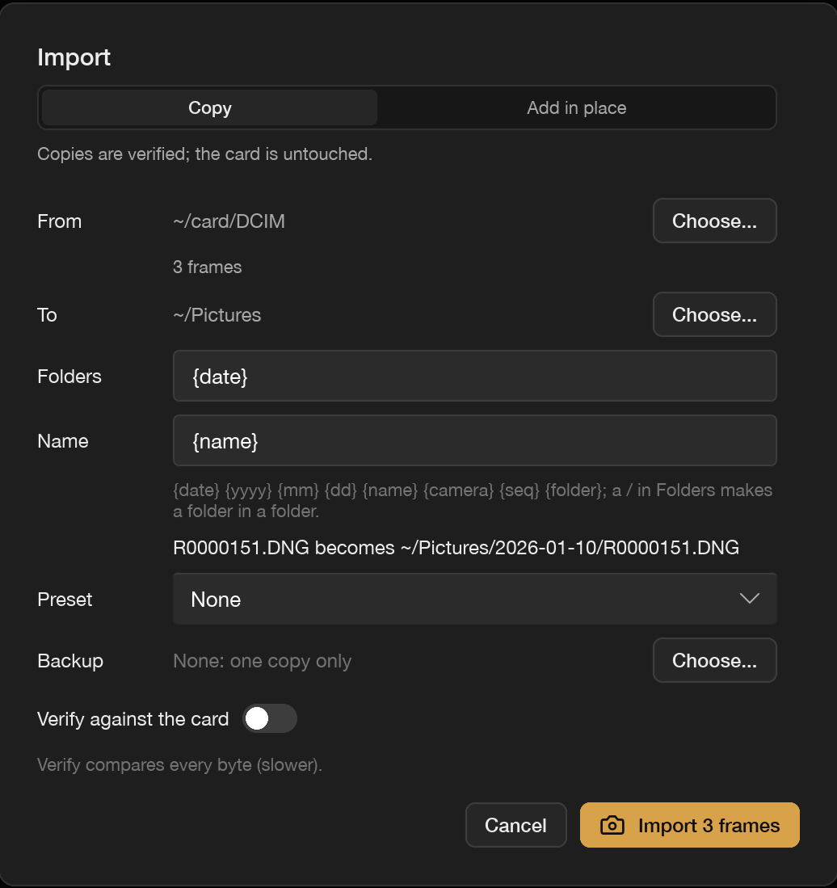
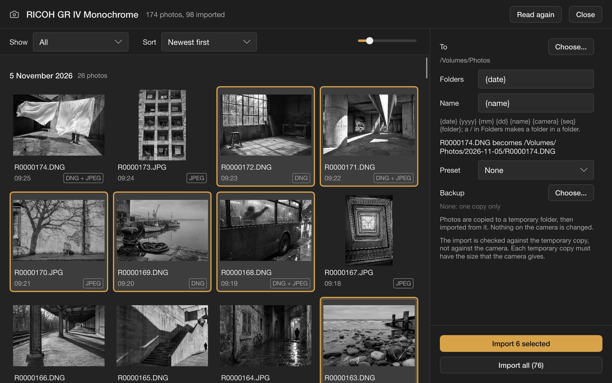

# Import

Monocard copies photos from a memory card, from a folder, or from a Ricoh GR IV Monochrome on a USB cable. It writes nothing on the card or the camera, and it deletes nothing there. On a Mac, use Cmd where this guide says Ctrl.

## Import from a card or folder

1. In the grid, click **Import...** in the left pane and choose **From a card or folder...**, or press **Ctrl+Shift+I**.
2. Check **From**. Monocard fills it in when it finds a card. To choose another folder, click **Choose...**.
3. Set the other rows.
4. Click the import button, for example **Import 214 frames**.

| Row | What it does |
| --- | --- |
| **To** | The folder that the photos go into |
| **Folders** | Folders to make inside **To**, as a pattern. Leave it empty for none |
| **Name** | The new file name, as a pattern. `{name}` keeps the camera's name |
| **Preset** | A preset to apply to each imported photo |
| **Backup** | A second folder that gets a copy of every file. **Clear** takes it off |
| **Verify against the card** | Compares photos already in **To** with the card, byte for byte |

The line below **Name** shows where the first photo goes.

### What is copied

- DNG files of a monochrome sensor, and monochrome JPEG, PNG, and TIFF files.
- The camera's JPEG of a raw, with the raw's new name.
- An `.xmp` file, with the photo that it belongs to.

Videos and other files stay on the card. With **Hide color photos** on, color photos stay on the card too.

### Patterns

| Token | Becomes |
| --- | --- |
| `{date}` | The day of the photo, such as `2026-09-24` |
| `{yyyy}` `{mm}` `{dd}` | The year, the month, and the day |
| `{name}` | The camera's file name, without its extension |
| `{camera}` | The camera model |
| `{seq}` | The number of the photo in this import, such as `0001` |
| `{folder}` | The photo's folder under **From** |

A `/` in **Folders** makes a folder in a folder, such as `{yyyy}/{date}`.

### Checks

Each copy is read back and compared with what was read from the card. If a file fails, the import stops and names it. Run the import again to continue.

A photo that you imported before is not copied again. A file is never written over: a new file with a name that is taken gets `-1` after it.

To stop an import, click **Stop import** in the left pane. The photo in hand is finished first.

## Add a folder in place

To add a folder to your library without a copy, choose **Add in place** at the top of the sheet. The folder becomes a [root](library.md#roots).

## The camera window

On a Mac, Monocard can import from a Ricoh GR IV Monochrome on a USB cable. Other cameras are not offered. This import has had little testing.

1. Connect the camera with a USB cable and turn it on. The camera window opens.
2. Wait for the list. It can grow for some seconds. If photos are missing, click **Read again**.
3. Set **To**, **Folders**, **Name**, **Preset**, and **Backup**, as for a card.
4. Select photos and click **Import selected**, or click **Import all**.

**Import all** leaves out the photos that are marked **Imported** and the ones that the window does not show. The window closes when the import ends without a fault. After a stop or a fault, it stays open and its marks show what is left.

| In the window | What it does |
| --- | --- |
| **Show** | **All** photos, or **Not imported**. The window keeps your choice for the next time |
| **Sort**, **Tile size** | The order and the size of the pictures |
| Click, Cmd+click, Shift+click, Cmd+A | Select one photo, add or remove one, select a range, select all |
| Arrow keys | Go to another photo |
| **Space** | Selects the photo, or clears it |
| Double-click, or **Return** | Shows a larger picture. The arrow keys go to the next one |
| **Esc** | Closes the larger picture, then clears the selection, then closes the window |

The window opens by itself one time for each connection, but not over a sheet or a menu, or during an import or an export. To open it yourself, click **Import...** and choose **From the camera...**. To keep it closed, turn off **Open the camera window when a camera is connected** in [Settings](settings.md#library).

### What is imported from the camera

- Only DNG and JPEG files are offered. Other files stay on the camera, and the window counts them.
- A DNG and a JPEG with the same name in the same folder are one photo.

The photos are copied to a temporary folder first, so the disk needs room for them twice. Each temporary copy must have the size that the camera gives. The import is checked against that copy and not against the camera.

If you click **Stop** during the copy from the camera, or disconnect the camera, nothing is imported.

Monocard does not take pictures with the camera, change its settings, delete its photos, or connect to it by Wi-Fi.

## A Lightroom catalog

**Import...** > **A Lightroom catalog...** reads a Lightroom Classic catalog (`.lrcat`). Quit Lightroom first.

Choose the catalog, and set the folders that were not found. Click **Check** and then **Write**.

It brings ratings, flags, color labels, keywords, titles, captions, crops, virtual copies as versions, stacks, and collections, and adds the folders as roots. Tone and color settings come as a step in the history, but the develop of a monochrome photo does not use them.

The import does not check whether a photo is monochrome. It writes `.mcd` files beside the color photos of the catalog too.

A photo that you edited or rated in Monocard is left as it is, unless you turn on the switch to write over it.
