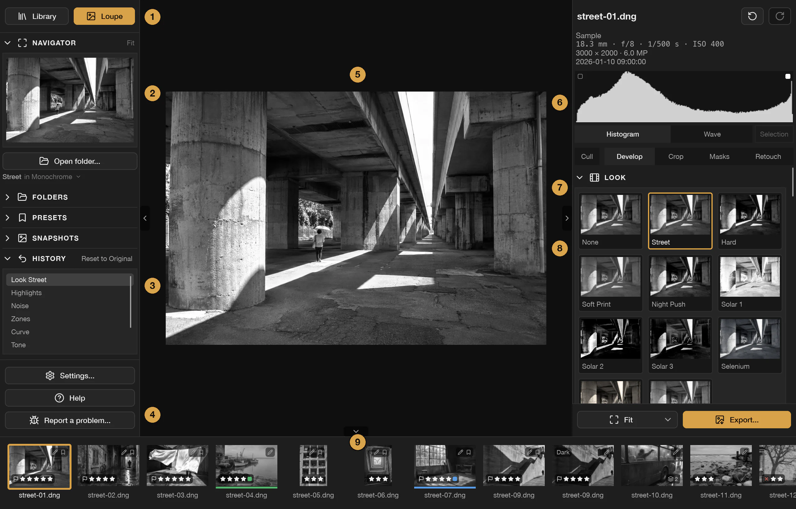

# Start

Monocard is a raw photo editor for cameras with a monochrome sensor. This chapter helps you install it, learn the window, and develop and export a first photo.

On a Mac, use **Cmd** where this guide says **Ctrl**.

## System requirements

| System | Version | Processor | Graphics |
| --- | --- | --- | --- |
| macOS | 13.4 or later | Apple silicon | The Mac's own |
| Linux | glibc 2.39 or later, and fontconfig | 64-bit Intel or AMD | A Vulkan driver |
| Windows | Windows 10 or later | 64-bit Intel or AMD | A driver for Vulkan or DirectX 12 |

The Linux and Windows versions have had little testing. [Import from the camera](import.md) by USB is for the Mac only.

Some [masks](masks.md#models) and some [retouch tools](crop-and-retouch.md) need a model. Monocard asks before it downloads one.

## Install

### macOS

1. Download [Monocard.dmg](https://github.com/sbusso/monocard/releases/latest/download/Monocard.dmg).
2. Open it and drag Monocard to Applications.

The app is signed and notarized.

### Linux

To run Monocard without an install, download the [AppImage](https://github.com/sbusso/monocard/releases/latest/download/Monocard-linux-x86_64.AppImage), make it executable, and run it.

To install Monocard for your user, download the `.tar.gz` archive from the [releases page](https://github.com/sbusso/monocard/releases), unpack it, and run `./install.sh`. To remove it, run `./uninstall.sh`.

### Windows

1. Download the [zip file](https://github.com/sbusso/monocard/releases/latest/download/Monocard-windows-x86_64.zip) and unpack it.
2. Run `bin\monocard-ui.exe`.

The programs are not signed, so Windows may ask before the first start. Keep the files of the `bin` folder together. To remove Monocard, delete the folder.

### Updates

Monocard asks GitHub once a day whether there is a new version. It sends only the version number. When there is one, a line above **Settings...** in the left pane says so. Monocard does not install it. To turn the check off, open **Settings...**, choose **About**, and clear **Check for a new version at launch**.

## The window

1. **Library** and **Loupe**, which switch the view
2. The navigator
3. The history of the edit
4. **Settings...**, **Help**, and **Report a problem...**
5. The photo
6. The scopes
7. The tabs
8. The panels of the tab
9. The filmstrip

| Part | What it holds |
| --- | --- |
| Left pane | **Library** and **Loupe** at the top, which switch the view. Below them are **Open folder...**, **Import...**, and the lists of the view. **Settings...**, **Help**, and **Report a problem...** are at the bottom. |
| Middle | The grid of photos in Library. One photo in Loupe. |
| Right pane | In Loupe, the name of the file, its exposure, the [scopes](develop.md#scopes), and the tabs. **Fit** and **Export...** are at the bottom. |
| Filmstrip | In Loupe, the photos of the folder, along the bottom. |

The tabs of the right pane are:

| Tab | Use it to | Chapter |
| --- | --- | --- |
| **Cull** | Rate, flag, and label photos | [Culling](culling.md) |
| **Develop** | Edit the whole photo | [Develop](develop.md) |
| **Crop** | Crop, rotate, and correct perspective | [Crop and retouch](crop-and-retouch.md) |
| **Masks** | Edit a part of the photo | [Masks](masks.md) |
| **Retouch** | Remove spots and objects | [Crop and retouch](crop-and-retouch.md) |

In Develop, the left pane has **NAVIGATOR**, **PRESETS**, **SNAPSHOTS**, and **HISTORY**. See [Presets and history](presets-and-history.md).

| Key | What it does |
| --- | --- |
| **G** | Opens the Library, or goes back to the Loupe |
| **E** | Opens the Loupe |
| **D** | Opens Develop |
| **Tab** | Hides or shows the panes and the filmstrip |
| **?** | Shows all the keys |

The list of all keys is in [Keys](keys.md).

## Your first photo

1. Click **Open folder...** or press **Ctrl+O**, and choose a folder of monochrome photos.
2. In the grid, choose a photo and press **D**. The camera's own preview shows first. Monocard's develop replaces it.
3. In **LOOK**, click a look, for example **Street**. Click **None** to take it off. See [Looks](looks.md).
4. In **BASIC**, move **Exposure**, **Blacks**, and **Whites**.
5. Press **Z** to see the photo in zones, and press **Z** again to go back.
6. Press **A** to see the photo as it was, and **B** to go back to your edit.
7. Click **Export...** or press **Ctrl+Shift+E**. Choose **Grey JPEG** in **Preset**, choose a folder, and click **Export**. See [Export](export.md).

Monocard saves the edit as you work. There is no Save command. Press **Ctrl+Z** to undo.

The first time you open a raw of a Ricoh GR IV Monochrome, a card shows some facts about the camera. Click **Start** to close it, or **Show Highlights** to open the HIGHLIGHTS panel.

## Where your edits are kept

Monocard never changes a photo. It keeps the edit in a file beside it: the edit of `IMG_0001.DNG` is in `IMG_0001.DNG.mcd`. When you move or back up your photos, take the `.mcd` files too.

To keep these files in a hidden `.monocard` folder instead, open **Settings...**, choose **Library**, and set **Edits go** to **Hidden folder**.

An edit that version 0.1.2 saved does not open in 0.1.0 or 0.1.1.

### Monocard and Greycard

Monocard is built on [Greycard](https://github.com/jessolmstead/greycard), and you can install both. They share no settings and no library.

- Monocard reads a `.gcd` file of Greycard when the photo has no `.mcd` file. The photo opens with that edit, rating, and flag.
- The first save in Monocard writes an `.mcd` file. After that, Monocard does not read the `.gcd` file.
- Monocard never writes a `.gcd` file. When it moves a photo, it moves the `.gcd` file with it. When it deletes a photo, the `.gcd` file stays.

## Which photos are listed

Monocard lists monochrome photos and color photos:

- DNG files of a monochrome sensor.
- A JPEG, PNG, or TIFF whose camera name says that it is monochrome, for example `RICOH GR IV Monochrome`.
- A JPEG, PNG, or TIFF with one channel.
- Color photos: raws of color cameras, and color JPEG, PNG, and TIFF files. Monocard shows them in grey. See [Color photos](develop.md#color-photos).

A JPEG beside a DNG of the same name goes with that DNG.

To leave color photos out, turn on **Hide color photos** in **Settings...**, **Editing**. Monocard reads it when it starts. A raw that is not a DNG counts as color. So does a black and white photo from another camera or a scanner that is kept in three channels, and a monochrome camera's JPEG with a color tone in it, such as sepia.

A camera's JPEG is already rendered by the camera. You edit it with the same panels, but some controls are for a raw only. See [Develop a JPEG](develop.md#develop-a-jpeg).

## Limits

- Monocard is made for the Ricoh GR IV Monochrome. DNGs of other monochrome cameras open, and they have had less testing.
- Import from the camera by USB is new and has had little testing.
- The bundled profile of the GR IV Monochrome holds no measurements. Monocard uses the noise that the DNG names, or estimates it from the photo. You can [measure your sensor](looks.md#measure-the-sensors-noise).
- The learned denoiser is not trained. **Fast** and **Best** use **Profiled** instead.
- The bundled looks **Solar 1**, **Solar 2**, and **Solar 3** are not matched to the camera's Solarized modes.
- No look of the camera's picture modes comes with Monocard. You [fit them from your own photos](looks.md#fit-a-mode-from-your-photos).
- Clipped light is lost. A monochrome sensor has no other channel to take it from.
- The text that Monocard adds to Greycard is in English only.

## Report a problem

Click **Report a problem...** at the bottom of the left pane. It opens the form of Monocard in your browser, with the version, the system, and the graphics card filled in. It also opens the folder of the log. Drag `monocard-ui.log` into the form.

Say what you did and what you expected. The logs of the three runs before are `monocard-ui-1.log`, the latest, to `monocard-ui-3.log`.

| System | Folder of the log |
| --- | --- |
| macOS | `~/Library/Logs/monocard` |
| Linux | `~/.local/state/monocard` |
| Windows | `%LOCALAPPDATA%\monocard\logs` |

You can also write on the [issues page](https://github.com/sbusso/monocard/issues). Do not send them to Greycard.
