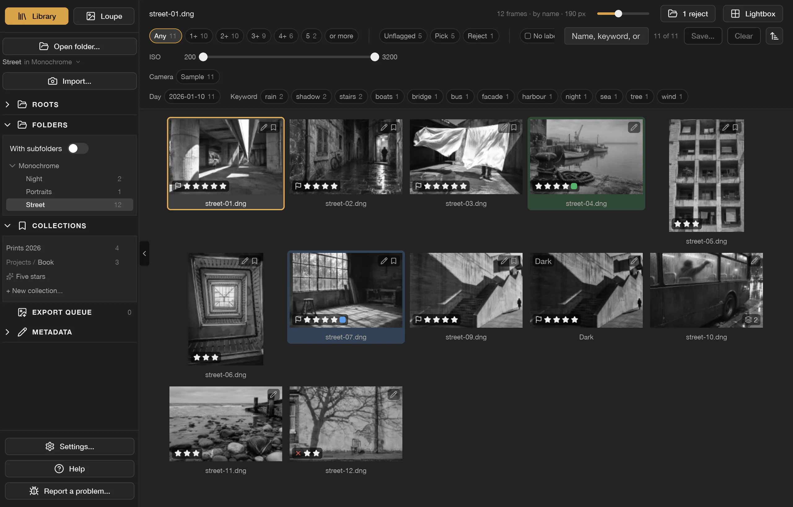
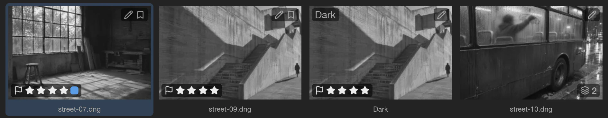
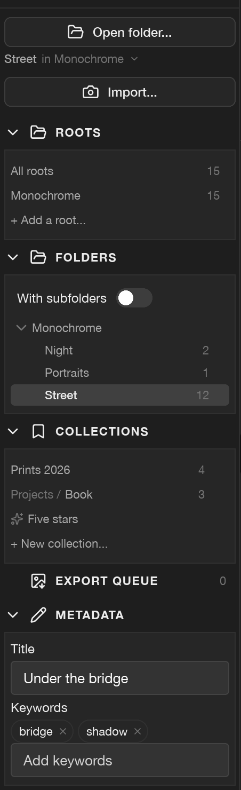
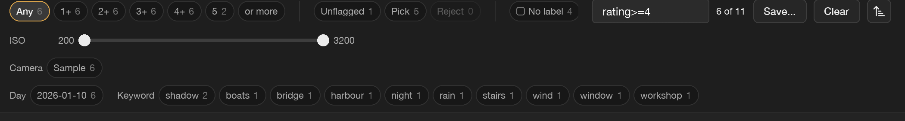

# Library

The Library shows your photos as a grid. This chapter describes how to open folders, filter and sort photos, add keywords, and use collections, stacks, and archives. On a Mac, use Cmd where this guide says Ctrl.

## Which photos are listed

Monocard lists monochrome photos only. Color photos are not listed, counted, or opened, and their files stay as they are. When a folder has no monochrome photos, the status line says so. For the exact rule, see [Which photos are listed](index.md#which-photos-are-listed).

A DNG and a JPEG with the same name in the same folder are one photo. The photo has the mark **+JPEG**, and one rating, flag, label, and set of keywords. To list the JPEG as its own photo, turn on **Treat a JPEG beside its raw as a separate frame** in [Settings](settings.md#library).

## Open a folder

Click **Open folder...** at the top of the left pane, or press **Ctrl+O**. The name of the open folder is below the button. Click the name for the last ten folders.

**Library** and **Loupe** at the top of the left pane switch between the grid and one photo.

**G** does the same. **E**, **Enter**, or a double-click opens the photo in the Loupe, and **D** opens it in Develop. For all the keys, see [Keys](keys.md).

## The grid

- Use the arrow keys, **Home**, and **End** to move.
- To select more photos, use Ctrl+click or Shift+click. **Ctrl+A** selects all the photos that are shown.
- To change the size of the tiles, drag **Tile size**, press **+** or **−**, or use Ctrl with the wheel. The size is from 96 to 512 pixels.
- Right-click a photo for its menu.

A photo with an edit shows the edit and not the camera's picture. These marks are at the top right of a thumbnail:

| Mark | Meaning |
| --- | --- |
| Pencil | The photo has an edit |
| Picture with an arrow | The photo was exported |
| Bookmark | The photo is in a collection |
| **+JPEG** | The camera's JPEG is with the raw |

A [version](presets-and-history.md#versions) has its own tile after the photo. A file that cannot be read says **Unreadable**.

## Roots

A root is a folder that you add to your library. Monocard keeps an index of the photos in it, so that you can filter all your roots together. The roots are under **ROOTS** in the left pane of the grid.

- To add a root, click **+ Add a root...**. To add the open folder, click **+ Add this folder**.
- **All roots** lists every photo in your library.
- Right-click a root for **Rename...**, **Use as an archive**, and **Remove from library**. These do not change the folder on the disk.

**FOLDERS** shows the folders inside the open root. Turn on **With subfolders** to show a folder with everything under it. When it is off, the folders inside the open folder are tiles above the photos.

A folder on your own disk is watched, and new photos show at once. A folder on a network is read again every 10 minutes. You can change the time in Settings.

When the disk of a root is not connected, the root says **offline**. You can still browse, filter, and cull its photos from the local previews.

## The filter bar

The filter bar is in the header of the grid and in the **CULLING** section. Press **Ctrl+F** or **/** to type in it.

| Control | What it shows |
| --- | --- |
| **Stars** | Photos with that rating. Click **or more** to change it to **exactly** |
| **Flag** | **Unflagged**, **Pick**, or **Reject** |
| **Label** | One of the five colors, or no label |
| **Camera**, **Lens**, **Day** | Photos with that value |
| **Kind** | **Raw**, **JPEG**, **PNG**, or **TIFF** |
| **Keyword** | Photos with that keyword |
| **ISO**, **Focal** | Photos in a range. Drag the two ends |

Chips of one group add to each other. Chips of different groups narrow each other. **Camera**, **Lens**, **Day**, **ISO**, and **Focal** show after Monocard has indexed the folder. **Clear** shows all the photos again.

Words in the text field find photos by file name or keyword. You can also type terms:

| Term | Example |
| --- | --- |
| `camera:`, `lens:`, `name:`, `folder:`, `keyword:` | `camera:GR` |
| `iso`, `focal`, `aperture`, `shutter`, `focus` | `iso>=3200` |
| `rating` | `rating>=3` |
| `date` | `date:2026-09` |
| `flag` | `flag:pick` |
| `label` | `label:none` |
| `kind` | `kind:raw` |
| `has:versions` | Photos that have a version |

Use `=`, `!=`, `<`, `<=`, `>`, and `>=` for numbers and dates. Put a value that has a space in double quotes.

## Sort

Click the arrows at the end of the filter bar. You can sort by **Capture time**, **Name**, **Rating**, **Date edited**, or **Focus**, in either direction. Focus is a score of how sharp the sharpest part of the photo is.

## Keywords and title

The **METADATA** section has **Title** and **Keywords**. It is in the left pane of the grid, and below the **CULLING** section in Cull.

- To add a keyword, type it and press **Enter** or a comma. To remove it, click the **x** on its chip.
- To keep a title, press **Enter**.

Both change all the selected photos. A keyword that only some of them have is dimmed. Click it to add it to the others.

## Collections

A collection is a list of photos from any folders, in an order that you choose. The photos stay where they are. Collections are under **COLLECTIONS** in the left pane of the grid.

- To make one, click **+ New collection...**.
- To add photos, press **B**, or right-click and choose **Add to collection**. Press **B** again to take them out. On the Develop tab with a monochrome photo, **B** shows the photo after the edit instead.
- To change the order, drag photos in the grid.
- Right-click a collection for **Rename...**, **Capture order**, and **Delete...**. Delete removes the collection and not its photos.

A smart collection is a saved filter. Set the filter bar, click **Save...**, and type a name. Its photos change as your ratings change.

## Stacks

A stack puts photos of one folder behind one photo.

- To make one, select photos and press **Ctrl+G**. To undo it, press **Ctrl+Shift+G**.
- To open or close it, press **S** in the grid, or click its badge.
- To put a photo on top, press **Shift+S** in the grid, or choose **Set as top of stack** in the menu.
- **Stack bursts** in the menu finds bursts and stacks each one, with its sharpest photo on top.

What you do to a closed stack, such as a rating or an export, is done to its top photo only.

## Archives

An archive is a root that holds the long-term copy of your photos, for example on a network drive. Right-click a root and choose **Use as an archive**.

- **Back up** copies the photos that are not on the archive, with their edits. Click the cloud button in the header of the grid, or right-click a photo and choose **Back up to** and the name of the archive.
- **Bring back** copies photos from the archive to another root.

Each copy is checked, and a picture on the archive is never written over.

## Where your edits are kept

The edit, rating, flag, label, and keywords of a photo are in an `.mcd` file beside it. See [Where your edits are kept](index.md#where-your-edits-are-kept). Monocard can also write an `.xmp` file for other programs. See [Sidecars](settings.md#library).
