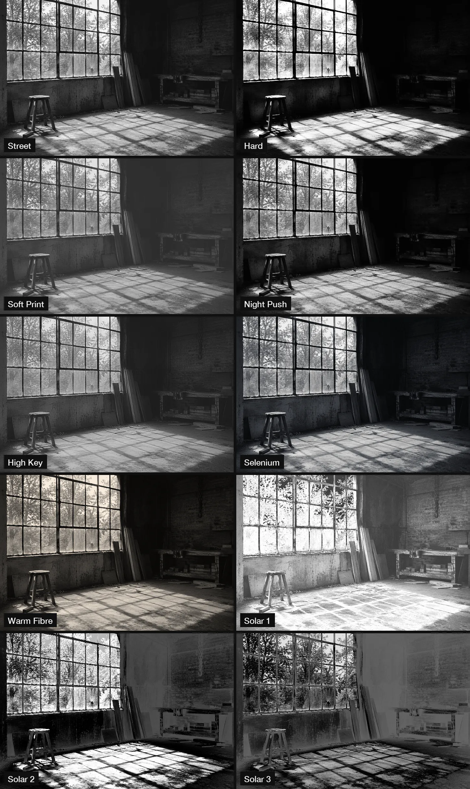
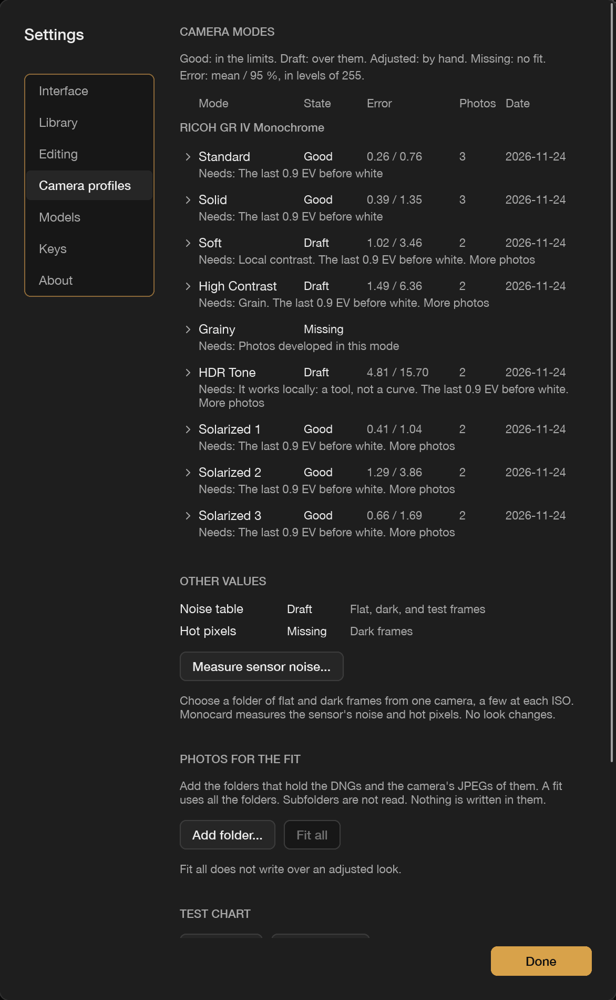

# Looks

A look sets several controls of the [Develop](develop.md) tab at once. This chapter covers the bundled looks, your own looks, the picture modes of a Ricoh GR, and recipes.

## Put a look on

Click a tile in the **LOOK** panel. Each tile shows the open photo under that look. A look replaces the one before it. **None** takes it off and puts its controls back.

**Strength** fades the look, from 0 to 100%. The controls hold the values of the look, so you can change any of them afterward.

| Look | What it does |
| --- | --- |
| **Street** | Neutral, full tonal range, a gentle shoulder |
| **Hard** | Deep blacks, strong midtone contrast, fine grain |
| **Soft Print** | Lifted blacks, paper white at 0.94, low contrast |
| **Night Push** | Pushed film, for ISO 12800 and up, with denoise and grain |
| **Solar 1**, **Solar 2**, **Solar 3** | Tone reversed about the middle, at both ends, or in the shadows |
| **Selenium** | A cool tone in the shadows only |
| **Warm Fibre** | A warm paper tone across the picture |
| **High Key** | Bright, few true blacks |



Solar 1 to 3 are not matched to the camera's Solarized modes. Selenium and Warm Fibre tone the photo, so it [exports in color](export.md#grey-or-color).

### Film looks for color photos

Twelve more looks are black and white film emulations from t3mujinpack by João Almeida (MIT), named with **(t3mujinpack)** after the film: AGFA APX 25 and 100, Fuji Neopan 1600 and Neopan Acros 100, Ilford Delta 100, 400 and 3200, FP4 125, HP5 Plus 400 and XP2, Kodak T-Max 3200 and Tri-X 400.

Each one sets the curve to the film's tone and the filter to the film's mix of colors to grey. The mix acts on color photos only. On a photo from a monochrome camera only the curve acts. The **Filter** row shows **From LUT**; choose a filter to take the film's mix off.

These looks are not the films of the [FILM panel](develop.md#film), which model the film's chemistry from its data sheet.

## Save your own look

1. Set the controls of the panels. A film and its settings are kept too.
2. Click **Save as look**, type a name, and click **Save**.

The look holds each control that is not at its default, **Exposure** too. It does not hold the crop, the lens, the masks, or the retouch. A name of your own that is in use is written over. A name of a bundled look is refused.

With a look on, **Export** shows four buttons:

| Button | What it writes |
| --- | --- |
| **Look** | The look's own file (`.toml`) |
| **1D LUT** | A 1D `.cube` of 4096 entries, for grey pictures: the look's tone, and its toning as one curve a channel |
| **3D LUT** | A 3D `.cube` of 33 points, for color pictures: the filter or film's conversion to grey, the tone, and the toning |
| **Lightroom** | A creative profile (`-profile.xmp`) and a Develop preset (`-preset.xmp`) |

Both LUTs take and give display-referred sRGB. They hold the tone and the toning only: the grain, the vignette, and the local contrast are not in a LUT.

The Lightroom profile converts to black and white and holds the look's conversion and tone as a table, which Lightroom's **Amount** slider scales. Put it in Camera Raw's `Settings` folder, then restart Lightroom. The preset puts the profile on, with the clarity, texture, grain, vignette, and toning (as split toning). Import it in Lightroom's **Presets** panel. Lightroom's sliders are not Monocard's, so the grain and vignette look different.

For your own looks, there are also **Rename** and **Delete**. Photos that have a renamed or deleted look keep their values, but **Strength** no longer works on them. The open photo follows a rename.

### Import a look, a Lightroom preset, or a LUT

Click **Import look, preset, or LUT** and choose a file:

- A look (`.toml`).
- A monochrome Lightroom preset (`.xmp`). Monocard takes the basic tone, the curves, clarity, texture, grain, split toning, and vignette. A line under the button lists what it left out, such as color values and masks. The picture is not equal to Lightroom's.
- A LUT: a `.cube` (1D or 3D) or a HaldCLUT `.png`, made for display-referred sRGB. The look takes the file's name.

A name that is in use is refused.

On a grey photo a 3D LUT acts only along its black-to-white line. So the look holds that line as an editable curve, and the difference between the LUT's channels on it as toning. The LUT's filter part, how it turns colors into greys, acts on color photos only:

- When a filter mix comes near the LUT, the look sets the **Filter** to that mix. The line under the button gives how near, in levels of 255.
- When none does (on average more than 1.5 levels off, or 4 levels for 95% of the colors), the line says so, and the look keeps the LUT's own conversion to grey in place of a filter.

In both cases the **Filter** row shows **From LUT**.

The curve is fitted under the default display transform, as for a raw. A camera JPEG has no display transform, so on a JPEG the look's tone differs from the LUT's.

### The file of a look

A look is a text file in TOML format. Monocard reads this folder when it starts:

| System | Folder |
| --- | --- |
| macOS | `~/Library/Application Support/monocard/looks-mono` |
| Linux | `~/.config/monocard/looks-mono` |
| Windows | `%APPDATA%\monocard\looks-mono` |

A file names only the values that it sets:

```toml
name = "My look"
description = "Soft, with grain."

[tools.display]
contrast = 1.3
white_ceiling = 0.95

[tools.grain]
amount = 0.25
```

To see the names of the sections and values, save a look and open its file. A control that shows a percentage is 0 to 1 in the file. A number out of range is set to the nearest end. A file with an unknown name is refused.

## The camera's picture modes

A Ricoh GR IV Monochrome writes its picture mode in each file. Ricoh calls it Image Control. The mode changes the JPEG only, and not the DNG.

Monocard can fit a look of a mode from pairs of a DNG and its JPEG. No such look comes with Monocard. Yours show under **Camera modes** in the LOOK panel when a raw of that camera is open, and not for a JPEG.

### What is measured

These results come from one camera and two photos of the test chart. Standard and Solid also use one scene. The error is the mean, in levels of 255.

| Mode | Result | Error | What is missing |
| --- | --- | --- | --- |
| Standard | Good | 0.26 | The last stop before white |
| Solid | Good | 0.39 | The same |
| Solarized 1 | Good | 0.41 | The same |
| Solarized 2 | Good, close to the limit | 1.29 | The same |
| Solarized 3 | Good | 0.66 | The same |
| Soft | Draft | 1.02 | Local contrast |
| High Contrast | Draft | 1.49 | Grain. The cause of the rest is not known |
| HDR Tone | Draft | 4.81 | It is local, so a curve is only near it |
| Grainy | Missing | | Photos |

The fit finds the tone curve only. Grain, sharpening, vignette, and toning are not fitted.

### Fit a mode from your photos

On the camera, set every parameter of the modes to its default. Turn off Highlight Correction, Shadow Correction, noise reduction, and Peripheral Illumination Correction.

1. Shoot RAW+JPEG in Standard, or develop one DNG in the camera in each mode. The Solarized modes need a Standard JPEG of the same DNG.
2. Copy the DNGs and the JPEGs to a folder. Do not edit them.
3. Open **Settings...** and choose **Camera profiles**.
4. Under **PHOTOS FOR THE FIT**, click **Add folder...**. Subfolders are not read, and nothing is written in the folder.
5. Click **Fit all**. A report says which files were left out, and why.

The **CAMERA MODES** table shows each mode:



| State | Meaning |
| --- | --- |
| **Good** | Fitted, and the error is in the limits, in levels of 255: mean 1.5, 95% of the blocks at 4 or less, largest 8 |
| **Draft** | Fitted, and the error is over the limits. You can use it, and its tile says draft |
| **Adjusted** | You changed the look by hand |
| **Missing** | There is no fit |

Click a row for **Use**, **Adjust**, **Export**, **Delete**, and **Fit** or **Fit again**. **Adjust** puts the look on the open photo. Change the controls, then save the look under the same name. **Fit all** does not write over an adjusted look.

### Help fit the modes

Soft, High Contrast, and HDR Tone are still drafts. Photos from more cameras make the fits better. The fit needs the test chart, shot at two exposures. To send yours:

1. On the camera, set every parameter of the modes to its default. Turn off Highlight Correction, Shadow Correction, noise reduction, and Peripheral Illumination Correction.
2. In **Settings...**, **Camera profiles**, under **TEST CHART**, click **Test chart**. It fills the screen with 40 grey steps over 10 stops.
3. Make the room dark. Put the camera on a tripod. Set RAW+JPEG, Standard mode, and manual exposure.
4. Set ISO 160 and a shutter of 1/30 s or longer. Make the focus a little soft.
5. Take two shots. In the first, the brightest step is just under white. Take the second 4 stops darker.
6. Develop the two DNGs in the camera in each mode. Soft, High Contrast, and HDR Tone help most.
7. Copy the DNGs and the JPEGs to a folder as they are. Do not edit them.
8. Send one of these:
   - A fitted mode: [fit the folder](#fit-a-mode-from-your-photos), click the mode's row, then click **Export**. This writes the look's own file (`.toml`).
   - The photos: put the DNGs and the JPEGs in a zip, and share a link to it.
9. [Open an issue](https://github.com/sbusso/monocard/issues/new) on GitHub with the file or the link. An issue is public.

### The test chart

Under **TEST CHART**, **Test chart** fills the screen with 40 grey steps over 10 stops. **Save chart...** saves it as a picture. The page says how to photograph it.

### Start from the camera's mode

A raw with no edit starts from the look of its camera's mode, so it opens as the camera's JPEG shows it. To start from no look, turn off **Start from the camera's mode** in **Settings...**, **Editing**. The setting is on by default.

The photo's own settings, such as Key and Contrast, then go over the look. A photo shot at the mode's defaults gets nothing more. Each setting moves one tool: Key moves Exposure, and Contrast moves Contrast. The size of each step is a first guess for now. Toning, grain, and HDR Tone level are not put on yet.

## Measure the sensor's noise

Take flat frames, evenly lit, and dark frames, with the lens cap on, a few at each ISO. Dark frames of one second or longer are for hot pixels.

1. In **Settings...**, **Camera profiles**, click **Measure sensor noise...**.
2. Choose the folder of the frames.

A report shows the result. Monocard keeps the profile in the `cameras` folder beside `looks-mono`, and uses it from the next develop. No look changes.

## Recipes

A recipe is the picture settings of the Ricoh GR IV Monochrome: a mode of Image Control and its parameters. Monocard keeps recipes to look at, compare, and set on the camera. A recipe does not change a photo or the camera. To develop a raw like a mode, use [a look](#the-cameras-picture-modes).

To open the book, go to the grid, click **Import...** in the left pane, and choose **Recipes...**.

| Button | What it does |
| --- | --- |
| **From this photo** | Makes a recipe from the settings that the open photo records. If the book has a recipe with the same settings, Monocard chooses that one |
| **New** | Makes a recipe of Standard with the default settings |
| **Import...** | Adds a recipe from a `.toml` file. A name that is in use is refused |
| **Compare with** | Shows the values of a second recipe. Rows with another value say **Differs** |
| **Duplicate**, **Export...**, **Delete** | Copies the recipe, writes it to a file in a folder, or deletes it |
| **Copy as text** | Puts the settings on the clipboard as plain text |

The rows are in the order of the camera's menu. A recipe has only the settings of its mode. When you choose another **Mode**, the settings that both modes have keep their values, and the others take their defaults. Changes are saved as you make them.

To use a recipe, set its values on the camera in Image Control, then save them in Custom 1 to 3.

The notes of a recipe from a photo start with the ISO, and with the red filter if it was on.

What is not certain:

- Ricoh does not publish which mode has which setting, the ranges, or the defaults. Monocard uses what others report.
- The names of the tonings and of the HDR Tone levels are reported too. No photo with a toning, or with a level other than **High**, was seen.
- The meaning of the recorded grain is known in part. **Recorded** and two numbers, or **Grainy default**, is what the photo says. If you choose a size, that value is replaced.

Each recipe is a file in the `recipes` folder beside `looks-mono`. A setting out of range is set to the nearest end. A file with an unknown mode, toning, or level is refused.
