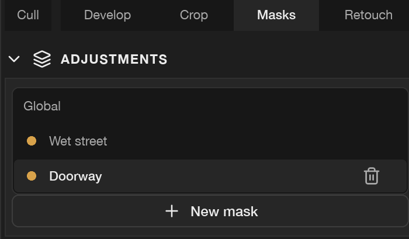
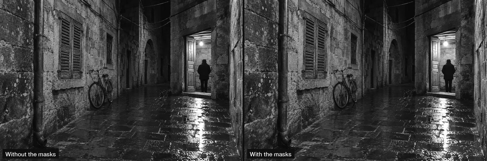
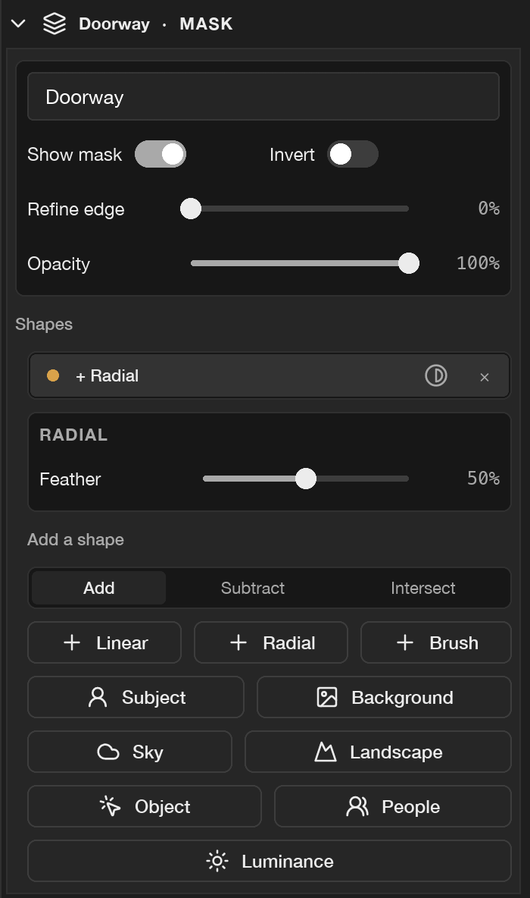
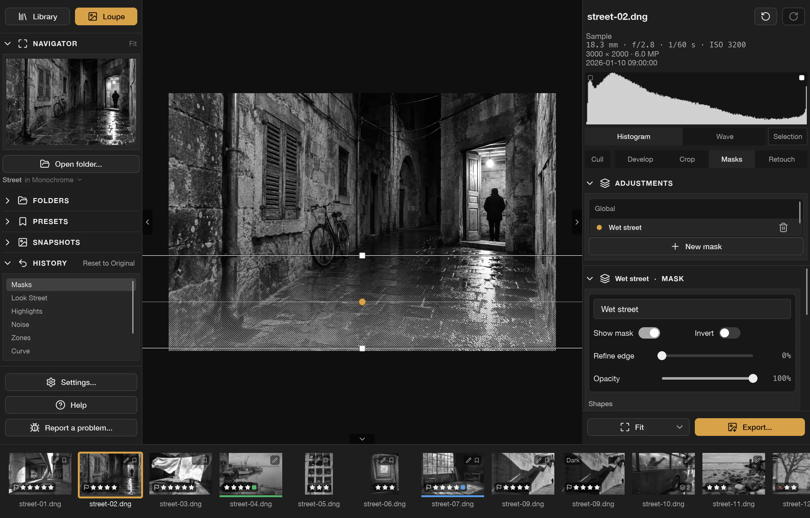
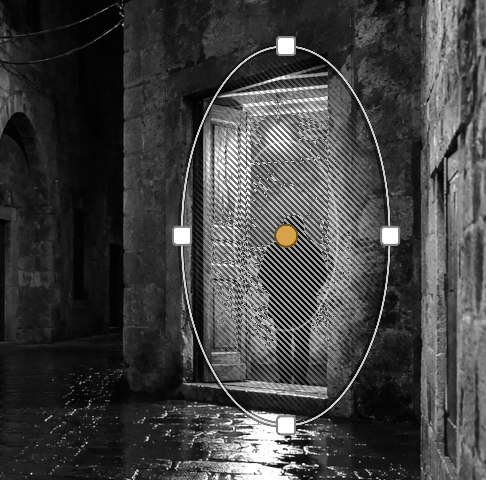
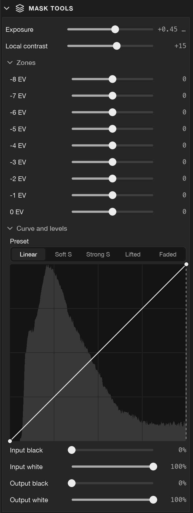

# Masks

A mask limits an edit to a part of the photo. You make masks on the **Masks** tab. The edit on the Develop tab stays under all of them.

## The list of masks

**ADJUSTMENTS** at the top of the tab holds **Global** and your masks. Click a row to choose it.

- **New mask** adds an empty mask. A photo can have up to 16.
- The dot of a row switches the mask on or off. The bin of the chosen row deletes it.
- Right-click a mask for **Duplicate mask**, **Copy mask**, **Copy masks**, and **Paste mask**. You can paste a mask on another photo.

| Key | What it does |
| --- | --- |
| **M** | Makes a mask with a Linear shape. The next drag places it |
| **Shift+M** | The same with a Radial shape |
| **O** | Shows or hides the chosen mask |
| **Esc** | Puts the drawing tool down |

## MASK

The section has the name of the mask, which you can change.

| Control | Range | Default | What it does |
| --- | --- | --- | --- |
| **Show mask** | On, off | Off | Marks the mask with diagonal stripes, stronger where it acts more. It turns off when you change a tool of the mask |
| **Invert** | On, off | Off | Acts where the shapes are not |
| **Refine edge** | 0 to 100% | 0% | Draws the edge of the mask to the edges in the photo |
| **Opacity** | 0 to 100% | 100% | Sets how much of the edit of the mask goes on |

**Shapes** lists the shapes of the mask. In a row, the dot switches the shape on or off, the half-filled circle inverts it, and **×** removes it. Click a row to see the settings of the shape.

## Add a shape

Click a button under **Add a shape**. From the second shape on, **Add**, **Subtract**, and **Intersect** set how the next one joins the mask:

| Choice | The mask becomes |
| --- | --- |
| **Add** | The mask and the shape |
| **Subtract** | The mask without the shape |
| **Intersect** | Only where both are |

### Linear and Radial

For **Linear**, drag across the photo. The edit is full where you start and fades to nothing where you stop. Hold **Shift** to keep the angle to steps of 15 degrees.

For **Radial**, press at the center and drag out. Hold **Shift** to keep a circle. **Feather** sets how much of the shape fades, from 0 to 100%. The default is 50%.

Drag the shape to move it, and its handles to change it.

### Brush

Click **Brush** and paint. While a brush is chosen, the button is **Paint**, and you go on with the same brush.

| Control | Range | Default | Keys |
| --- | --- | --- | --- |
| **Size** | 0.2 to 50% of the width | 5% | **[** and **]**, or the wheel |
| **Feather** | 0 to 100% | 50% | **Shift+[** and **Shift+]** |
| **Opacity** | 0 to 100% | 100% | **Ctrl+[** and **Ctrl+]** |

**Add** adds to the mask. **Subtract** takes from the whole mask. **Erase** removes only what this brush painted.

### Luminance

**Luminance** takes a range of tones, from **Low** to **High**. **Low fade** and **High fade** soften its ends.

| Control | Range | Default |
| --- | --- | --- |
| **Low** | 0 to 100 | 70 |
| **Low fade** | 0 to 50 | 10 |
| **High** | 0 to 100 | 100 |
| **High fade** | 0 to 50 | 0 |

It reads the light of the photo at the global **Exposure**, before the curve and the display transform. The tools of a mask do not move it.

### Subject, Background, Sky, and others

A learned model finds these shapes.

| Button | What it takes |
| --- | --- |
| **Subject** | The main subject |
| **Background** | Everything but the subject |
| **Sky** | The sky. **Pick** then adds sky with a click, and removes it with a right-click |
| **Landscape** | Opens a menu of what it found, such as water or foliage |
| **Object** | What you click. Right-click to leave something out, or drag a box |
| **People** | Opens a menu: the whole person, or a part such as **Face** or **Hair** |

A model can be wrong. Check the result with **Show mask**.

### Models

Monocard asks before it downloads a model, and the sheet names the model and its size. The models that are there, and what they need, are in **Settings...**, **Models**. See [Settings](settings.md).

The models work on a grey copy of your photo. The photo does not leave your computer.

## MASK TOOLS

These tools act only where the mask is.

| Control | Range | Default | What it does |
| --- | --- | --- | --- |
| **Exposure** | -4 to +4 EV | 0 | Lightens or darkens |
| **Local contrast** | -100 to +100 | 0 | Changes local contrast |
| **Zones** | -2 to +2 EV each | 0 | The nine sliders of [LIGHT](develop.md#light), **-8 EV** to **0 EV** |
| **Curve and levels** | | | **Preset**, the curve, and the levels, as in [BASIC](develop.md#curve) |

The reset arrow puts the tools back and leaves the shapes. Double-click a slider to put it back to its default.

Contrast, blacks, midtones, whites, the contrast equalizer, sharpening, denoise, grain, and toning have no mask. Edit them for the whole photo on the Develop tab.

## Masks on other photos

[Sync and paste](presets-and-history.md) can copy masks to other photos. Subject, Background, Sky, Landscape, and People are made again for each photo.
