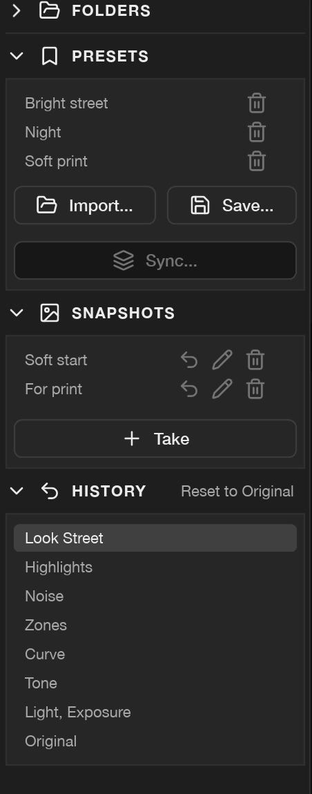
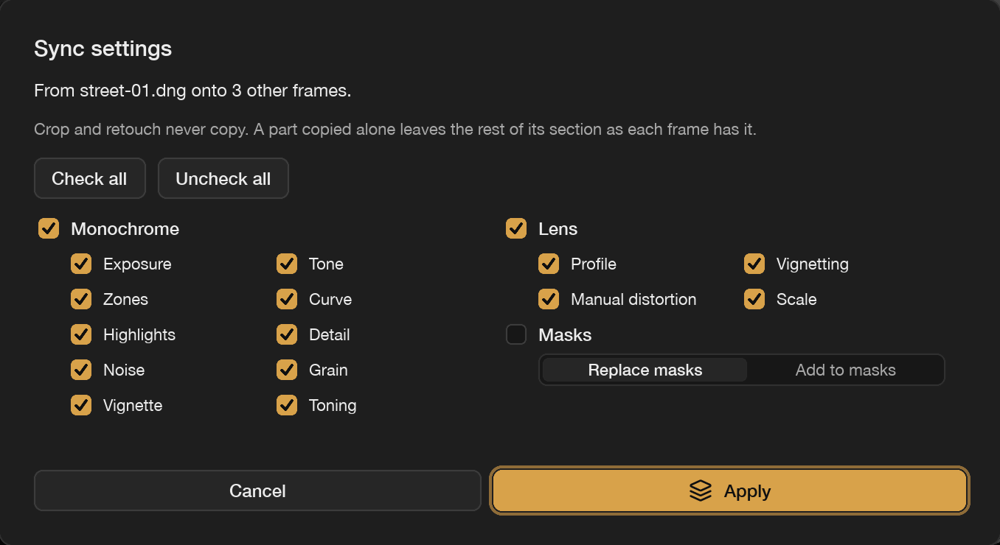
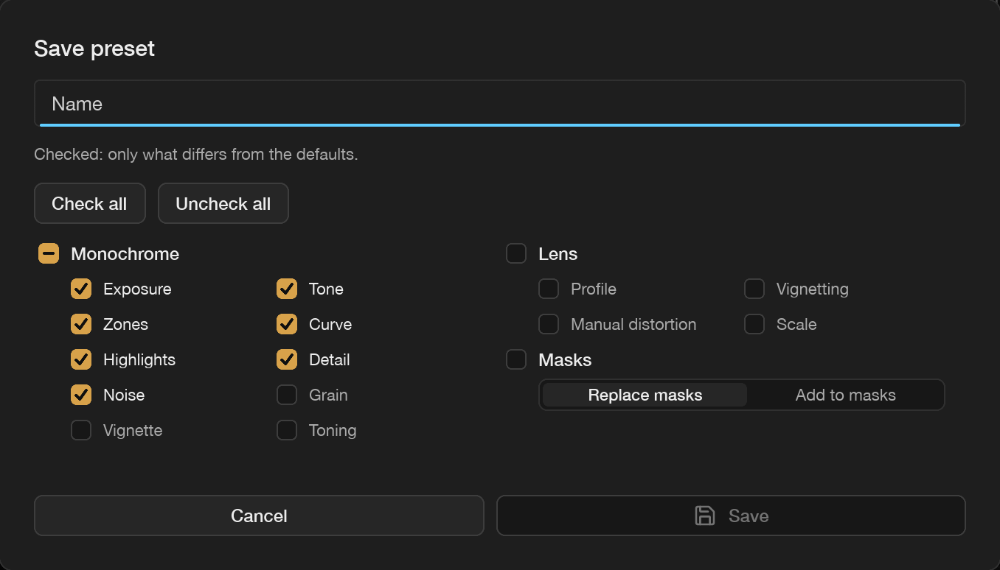

# Presets, history, and versions

Use presets and Sync to put an edit on other photos. Use the history, snapshots, and versions to keep and compare edits of one photo. In the Develop tab, the left pane has NAVIGATOR, PRESETS, SNAPSHOTS, and HISTORY. On a Mac, use Cmd where this guide says Ctrl.

## Undo

Press **Ctrl+Z** to undo a step, and **Ctrl+Shift+Z** or **Ctrl+Y** to redo it. Press **\\** to see the photo as it was before the edit.

To remove all of the edit, choose **Reset to Original** in the photo's menu. You can undo this too.

## History

HISTORY lists the steps of your edit, such as "Exposure +0.50 EV", "Look: Street", or "Preset: Soft". It keeps the last 50 steps and **Original**. An export adds a row too.

Hold the pointer over a step to see it on the photo. Click it to go back to it. The steps after it stay until you change something. **Reset to Original** puts the photo back to the start.

The history is kept with the edit, so it is there the next time that you open the photo.

## Snapshots

A snapshot is a state of the edit that you keep by name.

1. Click **Take** under SNAPSHOTS.
2. Type a name and press **Enter**.

Hold the pointer over a snapshot to see it on the photo. Each one has buttons to restore it, rename it, and remove it. To restore a snapshot is a step that you can undo.

## Versions

A version is a second edit of the same photo file. The photo is shown one time for each version.

| In the photo's menu | What it does |
| --- | --- |
| **New version** (**Ctrl+'**) | Makes a version that starts from this edit |
| **New version from the original** | Makes a version with no edit |
| **Rename version...** | Changes its name |
| **Swap with the original** | Makes this version the photo's own edit, and the other one the version |
| **Delete version...** | Asks, and then deletes this version. It cannot be undone |
| **Compare versions** | Shows the versions side by side in the Cull tab |

All versions are in the same `.mcd` file. They share the stars, the flag, the label, and the keywords. An export of a version has the name of the version, such as `IMG_0001-Name.jpg`.

## Copy an edit to other photos

### Sync

1. Select the photos. The photo that you are on gives the edit.
2. Click **Sync...** under PRESETS, press **Ctrl+Shift+S**, or use the button at the top of the panel, **Sync N frames to this one...**.
3. In **Sync settings**, check what to copy.
4. Click **Apply**.

Everything but the masks is checked at first. You can check a whole section or its parts. A part that you copy alone leaves the rest of its section as it is on each photo.

Crop and retouch are never copied.

To sync at once with no sheet, middle-click the sync button or a photo.

### Copy and paste

1. On one photo, press **Ctrl+C**, or choose **Copy settings** in its menu.
2. Select other photos, and press **Ctrl+V**, or choose **Paste settings**.
3. Check what to paste and click **Paste**.

## Presets

A preset is an edit, or a part of one, that you keep to use on other photos. Monocard has no presets of its own. A preset is different from a [look](looks.md): a preset can also hold a lens correction and masks.

### Save a preset

1. Click **Save...** under PRESETS.
2. Type a **Name**.
3. Check the parts to keep. The parts that differ from the defaults are checked.
4. Click **Save**.

| Section | What it holds |
| --- | --- |
| **Monochrome** | **Exposure**, **Tone**, **Zones**, **Curve**, **Highlights**, **Detail**, **Noise**, **Grain**, **Vignette**, and **Toning** |
| **Lens** | The lens corrections |
| **Masks** | The masks. **Replace masks** takes the photo's own masks off. **Add to masks** keeps them |

**Lens** and **Masks** are not checked at first. The name of a look is kept only with the whole **Monochrome** section.

### Use a preset

Click a preset to apply it to the selected photos. It is one step in the history. It replaces the parts that it holds and leaves the rest of the edit.

A preset can also be applied on [import](import.md#import-from-a-card-or-folder).

### Keep presets in order

- Click the star to make a preset a favorite. Favorites are at the top of the list too.
- Right-click a preset to use **Move to group** or **Remove from group**. **New group...** makes a group.
- Right-click the name of a group to use **Rename group...**.
- Click the bin, **Remove**, to delete a preset.

### Import a preset

**Import...** under PRESETS takes `.gcp` files, which is the format of Monocard and Greycard presets. Presets that have only color settings are not listed. To import a Lightroom preset, see [Looks](looks.md#import-a-look-or-a-lightroom-preset).

Presets are `.gcp` files in the `presets` folder. [Settings](settings.md#files) says where it is.
