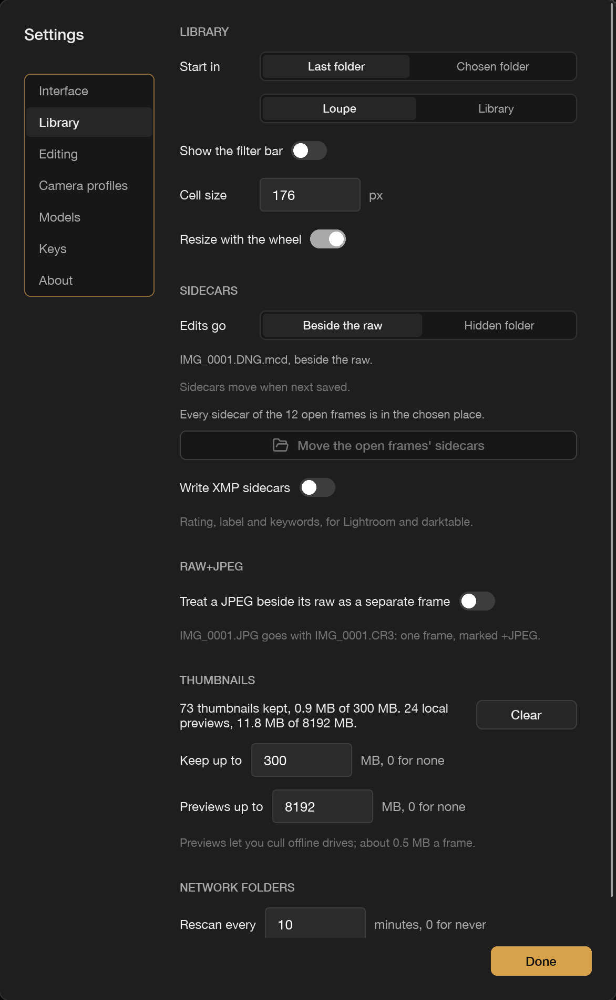
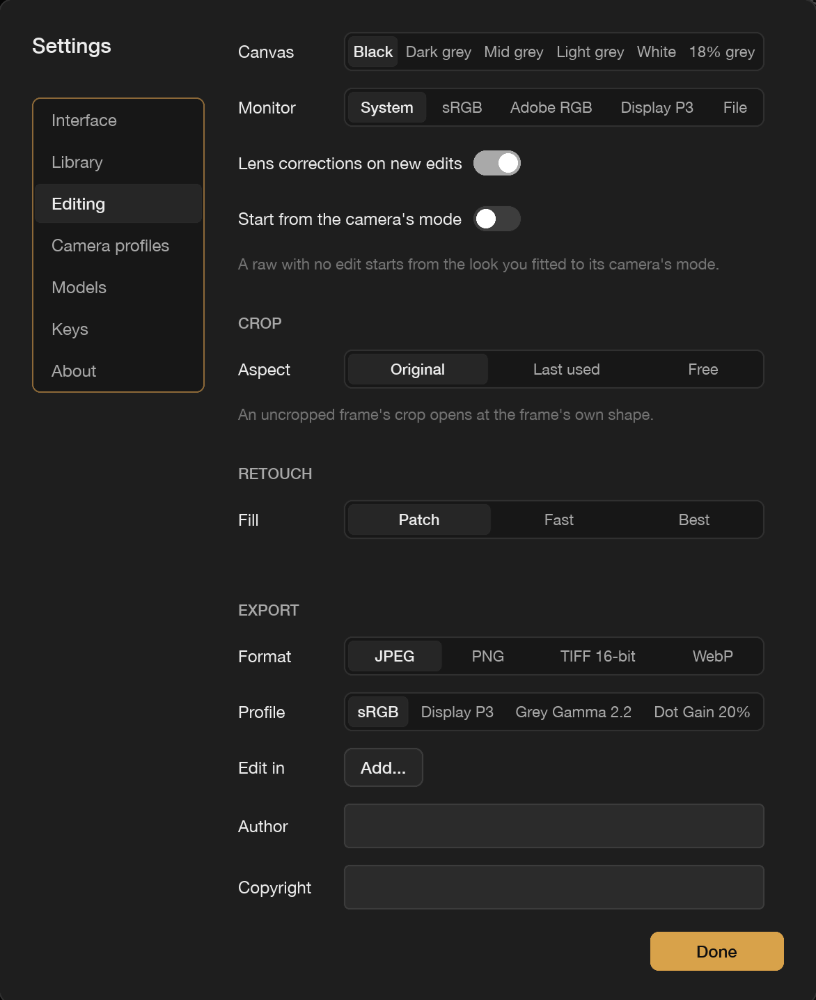
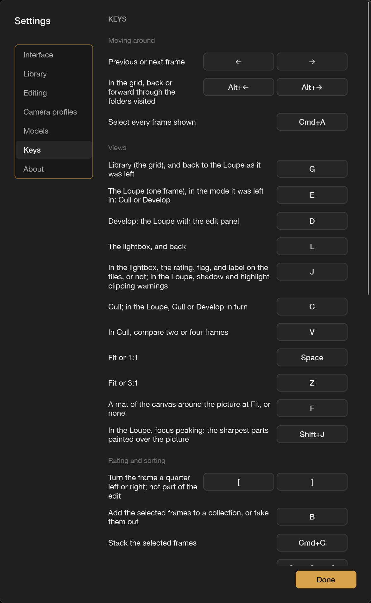
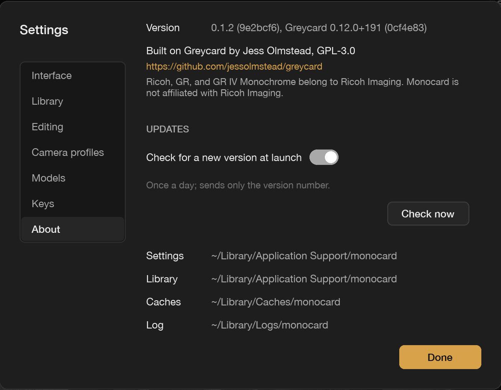

# Settings

The Settings sheet has seven pages. Click **Settings...** at the bottom of the left pane, or press **Ctrl+,**. A change is in effect at once, unless this chapter says that it needs a new start. To close the sheet, click **Done** or press **Esc**. On a Mac, use Cmd where this guide says Ctrl.

## Pages

### Interface

| Row | What it does |
| --- | --- |
| **Scale** | The size of the window's text and controls, from 50 to 300%. It needs a new start |
| **Theme** | **Charcoal**, **Grey**, or **Light** |
| **Scroll bars** | **Fade** or **Stay** |
| **Scroll bar size** | **Thin**, **Medium**, or **Wide** |
| **Language** | The language of the window. It needs a new start. The text that Monocard adds to Greycard is in English only |
| **One section open at a time** | Closes the other sections when you open one |
| **Reset section order** | Puts the panels back in their first order |

### Library

| Row | What it does |
| --- | --- |
| **Start in** | The folder to open at the start: the last one, or one that you choose |
| **Show the filter bar** | Shows the [filter bar](library.md#the-filter-bar) |
| **Cell size** | The size of the pictures in the grid, from 96 to 512 |
| **Resize with the wheel** | Lets the wheel change the size of the pictures |
| **Open the camera window when a camera is connected** | macOS only. See [The camera window](import.md#the-camera-window) |
| **Edits go** | **Beside the raw**, or to a **Hidden folder** named `.monocard` |
| **Move the open frames' sidecars** | Moves the edits of the photos on screen to that place now. Other edits move when you save them next |
| **Write XMP sidecars** | Also writes `.xmp` files for other programs. Flags are not in them |
| **Treat a JPEG beside its raw as a separate frame** | Lists the JPEG of a raw by itself |
| THUMBNAILS | The disk space for thumbnails and previews. **Clear** deletes the thumbnails |
| NETWORK FOLDERS | How often to look for changes in network folders, in minutes. 0 is never |

### Editing

| Row | What it does |
| --- | --- |
| **Canvas** | The color around the photo: **Black**, **Dark grey**, **Mid grey**, **Light grey**, **White**, or **18% grey**. It is **18% grey** at first |
| **Monitor** | The color space of your screen: **System**, **sRGB**, **Adobe RGB**, **Display P3**, or a profile **File** |
| **Lens corrections on new edits** | On at first |
| **Start from the camera's mode** | A raw with no edit starts from the look that you fitted to its camera's mode. Off at first. See [Looks](looks.md#start-from-the-cameras-mode) |
| CROP, **Aspect** | The aspect of a new crop: **Original**, **Last used**, or **Free** |
| RETOUCH, **Fill** | **Patch**, **Fast**, or **Best**. See [Fill](crop-and-retouch.md#fill) |
| EXPORT, **Format** | **JPEG**, **PNG**, **TIFF 16-bit**, or **WebP** |
| EXPORT, **Profile** | **sRGB**, **Display P3**, **Grey Gamma 2.2**, or **Dot Gain 20%** |
| **Edit in** | The programs for [Edit in](export.md#edit-in-another-app). **Add...** adds one |
| **Author**, **Copyright** | Text to write in exported files |

### Camera profiles

This page has the looks that you fitted to your camera's picture modes. See [Looks](looks.md#the-cameras-picture-modes).

| Part | What it has |
| --- | --- |
| CAMERA MODES | One row for each mode, with its state, error, number of photos, and date. You can use, adjust, export, delete, or fit it |
| OTHER VALUES | **Measure sensor noise...** |
| PHOTOS FOR THE FIT | The folders to read. **Add folder...**, **Remove from list**, and **Fit all** |
| TEST CHART | **Save chart...** saves the chart to photograph |

### Models

This page lists the models that Monocard can download, such as those for [masks](masks.md#models) and [Fill](crop-and-retouch.md#fill). Each row shows the use, the license, the size, and the status. **Download all** shows the size of all of them. You do not need them all: the develop of a monochrome photo does not use the denoise models.

### Keys

This page lists the [keys](keys.md) that you can change. Click a key and press the new one. **Esc** keeps the old one. **Delete** or **Backspace** sets it to none. **Reset to defaults** puts all keys back.

### About

This page shows the version of Monocard, the version of Greycard that it is built on, and the credits.

| Row | What it does |
| --- | --- |
| **Check for a new version at launch** | Asks GitHub for the latest version, once a day. It sends only the version number. It is on at first |
| **Check now** | Asks now |
| **Settings**, **Library**, **Caches**, **Log** | The folders that Monocard uses. Click one to open it |

When there is a new version, a button above **Settings...** says that it is available. The button opens the page of the release in your browser. Monocard does not download or install it. **Not now** hides the button.

## Files

| Files | macOS |
| --- | --- |
| Settings, library, collections, presets, looks, camera profiles | `~/Library/Application Support/monocard` |
| Thumbnails, previews, masks, models, lens database | `~/Library/Caches/monocard` |
| Log | `~/Library/Logs/monocard` |

| Files | Linux |
| --- | --- |
| Settings, presets, looks, camera profiles | `~/.config/monocard` |
| Library, collections | `~/.local/share/monocard` |
| Thumbnails, previews, masks, models, lens database | `~/.cache/monocard` |
| Log | `~/.local/state/monocard` |

| Files | Windows |
| --- | --- |
| Settings, presets, looks, camera profiles | `%APPDATA%\monocard` |
| Library, collections, thumbnails, previews, masks, models, lens database | `%LOCALAPPDATA%\monocard` |
| Log | `%LOCALAPPDATA%\monocard\logs` |

In the settings folder, `settings.json` holds the settings, `presets` the presets, `looks-mono` the looks, and `cameras` the camera profiles. In the library folder, `library.sqlite` holds the index of your photos.

Your edits are not in these folders. They are in `.mcd` files with your photos. See [Where your edits are kept](index.md#where-your-edits-are-kept).

To get back disk space, quit Monocard and delete `thumbs`, `models`, `masks`, `denoise`, or `lensfun` in the folder of the thumbnails. Monocard makes or downloads them again when it needs them.

If `settings.json` cannot be read, Monocard starts with the default settings and keeps the old file as `settings.json.bad`.
